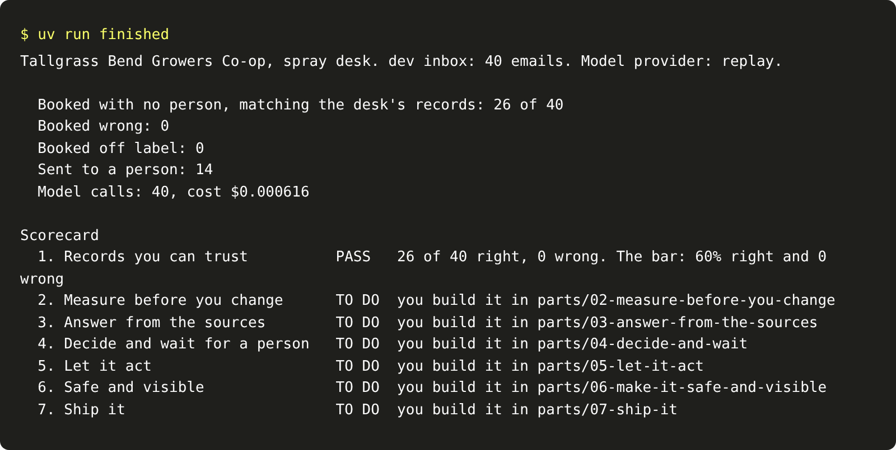
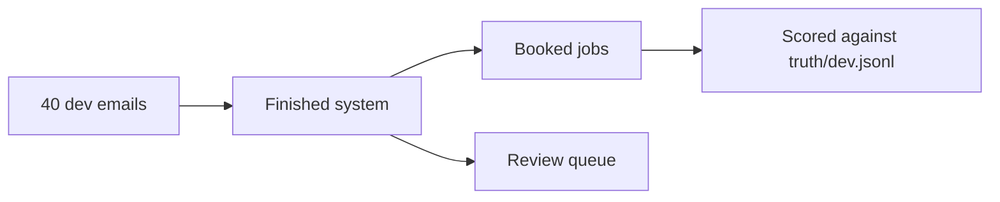

# Run the finished system

## The problem

Before you build anything, you need to know what finished looks like. Here, finished does not mean "the model
gave a nice answer". It means a number that the co-op's own records agree with. There are three numbers:

- how many emails were booked right with no person
- how many were booked wrong
- how many went to a person

## Your challenge

Run the finished system on the dev inbox. Then copy three of its numbers into `goal.md` in this folder.

```bash
uv run finished
```

Expect: a short report, then a scorecard with line 1 `PASS` and lines 2 to 7 `TO DO`.



For example, the report has the line `Booked with no person, matching the desk's records: 26 of 40`. In
`goal.md`, you replace the TODO on that line with `26`. Do the same for `Booked wrong` and `Sent to a person`.



## Done when

- `goal.md` has the number booked with no person, and it matches the finished system.
- `goal.md` has the number booked wrong, and it matches.
- `goal.md` has the number sent to a person, and it matches.

```bash
bun run verify run-the-finished-system
```

Expect: `Done. All 3 rules pass.`

## If you get stuck

- Copy only the number at the end of each line in the report. Write nothing after it.
- If `uv run finished` prints an error, find the message in `00-orientation/troubleshooting.md`.
- Notice that the model alone would book all 40 emails. The rules around the model decide which ones a person
  sees.

## Words you will use

- **System of record:** the business system whose state counts. Here, it is the co-op's application system.
- **Truth:** a record of the right answer that the model never sees. Here, it is the jobs the desk typed in by
  hand.
- **Replay:** recorded model replies. With replay, the course runs the same way every time, with no key.
- **Review queue:** the place where work goes when the system is not sure. A person handles it.
