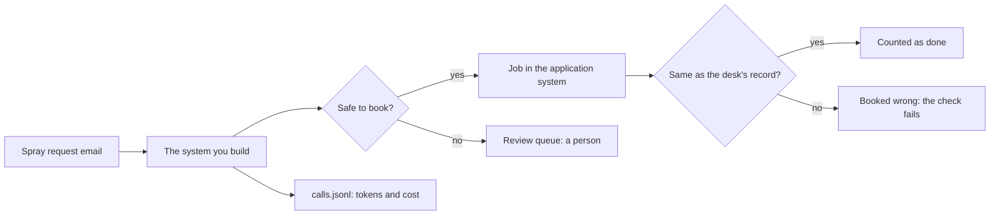
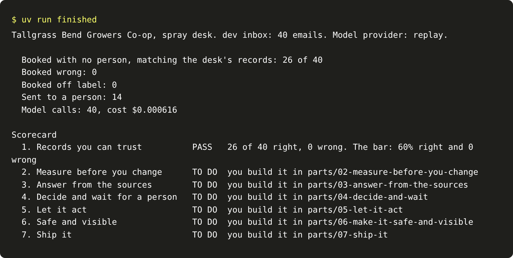

# Start here

You will set up the repo, meet the co-op you work for, run the finished system and see the goal. No model
key is needed: every command runs on replay, recorded model replies, until you choose a live provider.



## Walkthrough

**1. Set up.** You need git, [uv](https://docs.astral.sh/uv/) and [Bun](https://bun.sh). Then, in the repo:

```bash
uv sync
```

Expect: uv installs the Python packages and ends with no errors.

```bash
bun install
```

Expect: `bun install` ends with no errors.

```bash
uv run models
```

Expect: `Provider: replay`, three `PASS` lines (fast, smart and judge), then `Every role answered.`

To use a live model later, copy `.env.example` to `.env`, set `LLM_PROVIDER` and fill in that one key. Run
`uv run models` again to see the provider answer. Replay stays the default for every check.

**2. Meet the world.** You work at the spray desk of Tallgrass Bend Growers Co-op. Growers email spray
requests. A person keys each one into the co-op's application system: grower, field, product and rate. Read
[the world's brief](../worlds/tallgrass_bend/brief.md), then open one email:

```bash
uv run world email TB-1001
```

Expect: one line of JSON with `"email_id": "TB-1001"` and the email's text.

Reset the application system and look at what it holds:

```bash
uv run world reset
```

Expect: `The application system is reset: 8 growers, 17 fields, 6 products, no jobs.`

**3. Run the finished system.** It reads all 40 dev emails, books the safe ones, sends the rest to a person,
and scores itself against the desk's own records:

```bash
uv run finished
```

Expect: `Booked with no person, matching the desk's records: 26 of 40`, `Booked wrong: 0`, then a scorecard
whose first line says `PASS` and whose other six lines say `TO DO`.



To see the jobs board in a browser, run `uv run world serve` in a second terminal and open
http://127.0.0.1:8100. It prints `The spray desk is open at http://127.0.0.1:8100 (dev inbox).`

**4. See the goal.** Line 1 is part one of this course. You rebuild that system yourself, one step at a time,
and every later part turns one more line green. Copy three numbers from the run into the step below.

## The step

| Step                                                                    | Minutes | What you produce                             |
| ----------------------------------------------------------------------- | ------- | -------------------------------------------- |
| [run-the-finished-system](01-run-the-finished-system/problem/README.md) | 15      | `goal.md` with the finished system's numbers |

```bash
bun run verify run-the-finished-system
```

Expect: three `FAIL` lines, each with a `Try next:` line, until you fill in `goal.md`. Then `Done. All 3 rules pass.`

When a command prints something you do not expect, look it up in [troubleshooting.md](troubleshooting.md).

## Read before you start

Three pieces, read in this order:

1. [Building effective agents](https://www.anthropic.com/engineering/building-effective-agents), Anthropic.
   The words this course uses for a workflow and an agent.
2. [Demystifying evals for AI agents](https://www.anthropic.com/engineering/demystifying-evals-for-ai-agents),
   Anthropic. Why every step here is graded by a script that reads the end state.
3. The error analysis and LLM judge sections of [the evals FAQ](https://hamel.dev/blog/posts/evals-faq/) by
   Hamel Husain and Shreya Shankar. The evals part follows them.
