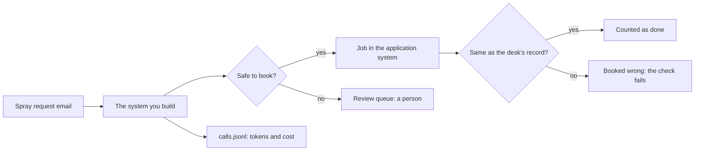

# Start here

On this page you set up the repo and meet the co-op you work for. Then you run the finished system and see
the goal. You do not need a model key. Every command runs on replay until you choose a live provider. Replay
means recorded model replies: the course plays back answers that a real model gave before.



## Walkthrough

**1. Set up.** You need git, [uv](https://docs.astral.sh/uv/) and [Bun](https://bun.sh). Then run these
commands in the repo:

```bash
uv sync
```

Expect: uv installs the Python packages and ends with no errors.

```bash
bun install
```

Expect: `bun install` ends with no errors.

```bash
uv run models
```

Expect: `Provider: replay`, three `PASS` lines (fast, smart and judge), then `Every role answered.`

Later, you may want a live model. Copy `.env.example` to `.env`. Set `LLM_PROVIDER` and fill in the one key for
that provider. Run `uv run models` again to see the provider answer. Every check still uses replay by default.

**2. Meet the world.** You work at the spray desk of Tallgrass Bend Growers Co-op. Growers email the desk to
ask for a crop spray. Today a person types each request into the co-op's application system. They type four
things: the grower, the field, the product and the rate. The rate is how much product goes on each hectare of
the field. Read [the world's brief](../worlds/tallgrass_bend/brief.md), then open one email:

```bash
uv run world email TB-1001
```

Expect: one line of JSON with `"email_id": "TB-1001"` and the email's text.

For example, the text of TB-1001 says: "Please book Podshield on Old Yard at 0.38 L/ha as soon as the wind
drops". Here, Podshield is the product, Old Yard is the field and 0.38 L/ha is the rate.

Next, reset the application system and look at what it holds:

```bash
uv run world reset
```

Expect: `The application system is reset: 8 growers, 17 fields, 6 products, no jobs.`

**3. Run the finished system.** It reads all 40 dev emails. It books the safe ones and sends the rest to a
person. Then it scores itself against the desk's own records:

```bash
uv run finished
```

Expect: `Booked with no person, matching the desk's records: 26 of 40`, `Booked wrong: 0`, then a scorecard
whose first line says `PASS` and whose other six lines say `TO DO`.


You can also see the jobs board in a browser. Run `uv run world serve` in a second terminal and open
http://127.0.0.1:8100. It prints `The spray desk is open at http://127.0.0.1:8100 (dev inbox).`

**4. See the goal.** Line 1 of the scorecard is the "Get records you can trust" part of this course. You build that system again
yourself, one step at a time. Each later part turns one more line green. Now copy three numbers from the run
into the step below.

## The step

| Step                                                                    | Minutes | What you produce                             |
| ----------------------------------------------------------------------- | ------- | -------------------------------------------- |
| [run-the-finished-system](01-run-the-finished-system/problem/README.md) | 15      | `goal.md` with the finished system's numbers |

```bash
bun run verify run-the-finished-system
```

Expect: three `FAIL` lines, each with a `Try next:` line, until you fill in `goal.md`. Then `Done. All 3 rules pass.`

Sometimes a command prints something you do not expect. Look up the message in
[troubleshooting.md](troubleshooting.md).

## Read before you start

Read these three pieces in this order:

1. [Building effective agents](https://www.anthropic.com/engineering/building-effective-agents), Anthropic.
   It gives the words this course uses for a workflow and an agent.
2. [Demystifying evals for AI agents](https://www.anthropic.com/engineering/demystifying-evals-for-ai-agents),
   Anthropic. It shows why a script grades every step here by reading the end state.
3. The error analysis and LLM judge sections of [the evals FAQ](https://hamel.dev/blog/posts/evals-faq/) by
   Hamel Husain and Shreya Shankar. The evals part of this course follows them.
