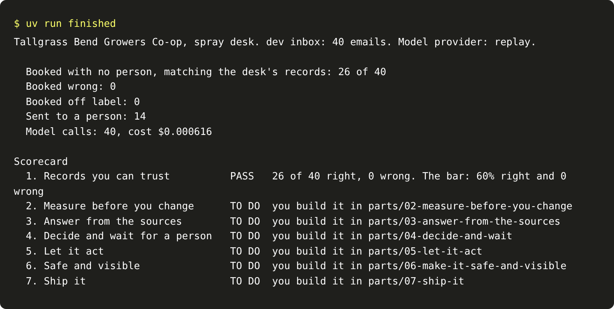
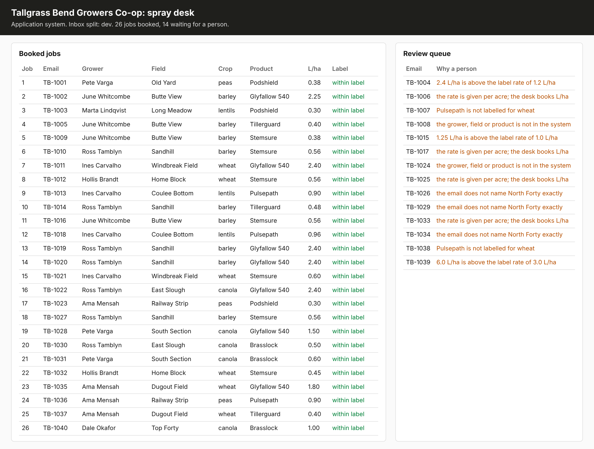
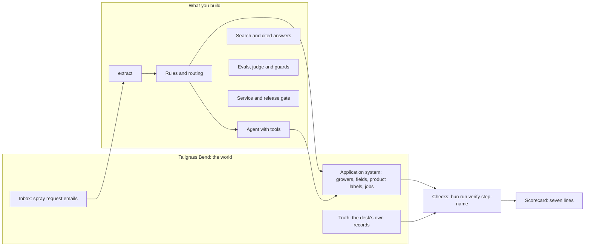

# Build One AI System You Can Prove

Take one real business job from a model call to a shipped system, and let a script prove it is right against
a record the model never saw, with its cost per outcome and a release gate.

**Who it is for:** software engineers who code well and are new to building with models. You know HTTP, SQL,
tests and git, and Python or TypeScript. You may have called a model API once or built a weekend demo. You
leave able to say how often your system is wrong, what each right answer costs, and what stops a worse version
from shipping.

**Not for:** people who do not write code, or engineers who want to train models from scratch.

## Run the finished system first

You need git, [uv](https://docs.astral.sh/uv/) and [Bun](https://bun.sh). No model key: the course runs on
replay, recorded model replies, until you choose a live provider.

```bash
uv sync && bun install
```

Expect: both finish with no errors.

```bash
uv run finished
```

Expect: `Booked with no person, matching the desk's records: 26 of 40`, `Booked wrong: 0`, `Booked off label: 0`,
`Sent to a person: 14`, then a scorecard with line 1 `PASS` and lines 2 to 7 `TO DO`.



That is the spray desk of Tallgrass Bend Growers Co-op, a fictional farmers' co-op. Growers email spray
requests. The finished system reads each email with a model, checks it against the co-op's application
system and the product label, books the safe ones and sends the rest to a person. Then it is scored against
the jobs the desk keyed by hand. The model's own words count for nothing.

```bash
uv run world serve
```

Expect: `The spray desk is open at http://127.0.0.1:8100 (dev inbox). Stop it with Ctrl+C.` Open it to see the
jobs board.



## What you build



Each part turns one line of the scorecard green. Every line is a script check on data the model never saw.

| Part | Scorecard line | Steps | Status |
|---|---|---|---|
| [Start here](00-orientation/README.md) | See the finish line | 1 | Built |
| [Get records you can trust](parts/01-get-records-you-can-trust/README.md) | 1. Correct records, zero wrong, cost counted | 6 | Built |
| [Measure before you change](parts/02-measure-before-you-change/README.md) | 2. Golden set, an aligned judge, a blocked bad change | 8 | Planned |
| [Answer from the sources](parts/03-answer-from-the-sources/README.md) | 3. Recall you can measure, every answer cited | 7 | Planned |
| [Decide and wait for a person](parts/04-decide-and-wait/README.md) | 4. Routing, and an approval that survives a crash | 7 | Planned |
| [Let it act](parts/05-let-it-act/README.md) | 5. An agent graded by the system's end state | 8 | Planned |
| [Make it safe and visible](parts/06-make-it-safe-and-visible/README.md) | 6. Traces, cost per outcome, private data and planted instructions | 7 | Planned |
| [Ship it](parts/07-ship-it/README.md) | 7. A service and a release gate in CI | 6 | Planned |
| [Add one capability](parts/08-add-one-capability/README.md) | An elective, measured | 4 | Planned |

Each part links the [live-labs](https://github.com/learnwithparam/live-labs) labs that teach its tools. The
steps here are the challenges; the labs are the lessons.

## How a step works

Each step has one problem, one outcome and one check. You work in the step's `problem/` folder, in your own
editor and tools, then run its check by name:

```bash
bun run verify name-the-job
```

Expect: `FAIL` lines, each with a `Try next:` sentence, until your work meets the rule. Then `Done.`

Checks run the commands your `contract.toml` names and read the application system's state and the call log,
never the model's reply. So any language or framework passes. `bun run verify part <part-name>` checks a whole
part. The sample `solution/` and the common `wrong/` answers sit beside each step.

## The project

You ship one repo grown across the parts, on Tallgrass Bend or on a brief from [the worlds](worlds/README.md):
a claims insurer, an electric co-op's work orders, an auction house's catalogue, a home care agency, a national
park's trail desk, or a job of your own with 40 records a person signed off. It ends with seven green lines on
a hidden test split, a pull request where CI blocked a worse prompt, a runbook, a short demo and a write-up
with three numbers: accuracy against truth, cost per correct outcome, and the judge's agreement with people.

## Models

`config/models.py` is the only file that names a model. Code asks for a role: `fast`, `smart` or `judge`.
`LLM_PROVIDER` picks `replay` (the default), `anthropic`, `openrouter`, `openai` or `ollama`, with its one key
in a git-ignored `.env` (see `.env.example`). Calls go through [LiteLLM](https://github.com/BerriAI/litellm).

```bash
uv run models
```

Expect: `Provider: replay`, three `PASS` lines and `Every role answered.`

## Read before you start

1. [Building effective agents](https://www.anthropic.com/engineering/building-effective-agents), Anthropic.
2. [Demystifying evals for AI agents](https://www.anthropic.com/engineering/demystifying-evals-for-ai-agents),
   Anthropic.
3. The error analysis and LLM judge sections of [the evals FAQ](https://hamel.dev/blog/posts/evals-faq/) by
   Hamel Husain and Shreya Shankar.

Times for one-day, four-evening and six-week runs are in `schedules.toml`. The rules this repo follows are in
[STANDARD.md](STANDARD.md), the plan for the remaining parts in [PARTS.md](PARTS.md), and the source of every
public number in [SOURCES.md](SOURCES.md).
