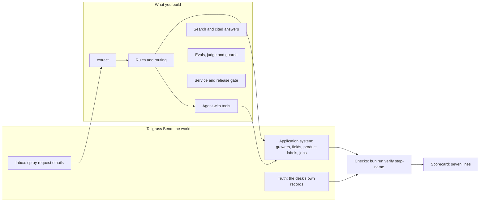

# Build One AI System You Can Prove

In this course you take one real business job and build an AI system for it. You start with a single model
call. You end with a system you can ship. A script proves the system is right. It compares the system's work
with a record the model never saw. You also count what each right answer costs, and you build a release gate:
a check that stops a worse version from shipping.

**Who it is for:** software engineers who code well and are new to building with models. You know HTTP, SQL,
tests and git. You also know Python or TypeScript. Maybe you called a model API once, or built a small demo.
At the end, you can say three things about your system. You know how often it is wrong. You know what each
right answer costs. And you know what stops a worse version from shipping.

**Not for:** people who do not write code, or engineers who want to train models from scratch.

## Run the finished system first

You need git, [uv](https://docs.astral.sh/uv/) and [Bun](https://bun.sh). You do not need a model key. The
course runs on replay until you choose a live provider. Replay means recorded model replies: the course plays
back answers that a real model gave before.

```bash
uv sync && bun install
```

Expect: both finish with no errors.

```bash
uv run finished
```

Expect: `Booked with no person, matching the desk's records: 26 of 40`, `Booked wrong: 0`, `Booked off label: 0`,
`Sent to a person: 14`, then a scorecard with line 1 `PASS` and lines 2 to 7 `TO DO`.


What you see is the spray desk of Tallgrass Bend Growers Co-op. It is a made-up farmers' co-op. Growers email
the desk to ask for a crop spray. The finished system works through each email in four steps:

1. A model reads the email.
2. The system checks the request against the co-op's application system and the product label.
3. It books the safe requests as jobs.
4. It sends the rest to a person.

Then a script scores the result against the jobs the desk typed in by hand. What the model says about its own
work counts for nothing.

For example, the email `worlds/tallgrass_bend/inbox/dev/TB-1001.txt` comes from a grower called Pete. It says:
"Please book Podshield on Old Yard at 0.38 L/ha as soon as the wind drops". The label allows up to 0.5 L/ha of
Podshield on peas, so the system books it. The desk's own record for TB-1001 has the same field, product and
rate, so this job counts as right.

```bash
uv run world serve
```

Expect: `The spray desk is open at http://127.0.0.1:8100 (dev inbox). Stop it with Ctrl+C.` Open it to see the
jobs board.


## What you build



Each part of the course turns one line of the scorecard green. Every line is a check by a script. The script
uses data the model never saw.

| Part                                                                      | Scorecard line                                                     | Steps | Status  |
| ------------------------------------------------------------------------- | ------------------------------------------------------------------ | ----- | ------- |
| [Start here](00-orientation/README.md)                                    | See the finish line                                                | 1     | Built   |
| [Get records you can trust](parts/01-get-records-you-can-trust/README.md) | 1. Correct records, zero wrong, cost counted                       | 6     | Built   |
| [Measure before you change](parts/02-measure-before-you-change/README.md) | 2. Golden set, an aligned judge, a blocked bad change              | 8     | Planned |
| [Answer from the sources](parts/03-answer-from-the-sources/README.md)     | 3. Recall you can measure, every answer cited                      | 7     | Planned |
| [Decide and wait for a person](parts/04-decide-and-wait/README.md)        | 4. Routing, and an approval that survives a crash                  | 7     | Planned |
| [Let it act](parts/05-let-it-act/README.md)                               | 5. An agent graded by the system's end state                       | 8     | Planned |
| [Make it safe and visible](parts/06-make-it-safe-and-visible/README.md)   | 6. Traces, cost per outcome, private data and planted instructions | 7     | Planned |
| [Ship it](parts/07-ship-it/README.md)                                     | 7. A service and a release gate in CI                              | 6     | Planned |
| [Add one capability](parts/08-add-one-capability/README.md)               | An elective, measured                                              | 4     | Planned |

Each part links to the [live-labs](https://github.com/learnwithparam/live-labs) labs that teach its tools. The
labs are the lessons. The steps here are the challenges.

## How a step works

Each step has one problem, one outcome and one check. You work in the step's `problem/` folder. Use your own
editor and tools. Then run the step's check by its name:

```bash
bun run verify name-the-job
```

Expect: `FAIL` lines, each with a `Try next:` sentence, until your work meets the rule. Then `Done.`

The check never reads the model's reply. It runs the commands that your `contract.toml` names. Then it reads
the state of the application system and the call log. So you can pass with any language or framework. To check
a whole part, run `bun run verify part <part-name>`. Each step also has a sample answer in `solution/`, and
common wrong answers in `wrong/`.

## The project

You ship one repo, and it grows with each part. You can build it on Tallgrass Bend. You can also pick a brief
from [the worlds](worlds/README.md):

- a claims insurer
- an electric co-op's work orders
- an auction house's catalogue
- a home care agency
- a national park's trail desk
- a job of your own, with 40 records a person signed off

At the end, all seven scorecard lines are green on a hidden test split. A split is a set of examples you keep
apart. You also have a pull request where CI blocked a worse prompt, a runbook and a short demo. Last, you write
up three numbers: accuracy against truth, cost per correct outcome, and how often the judge agrees with people.

## Models

Only one file names a model: `config/models.py`. Your code asks for a role instead: `fast`, `smart` or
`judge`. `LLM_PROVIDER` picks who serves the model. It can be `replay` (the default), `anthropic`,
`openrouter`, `openai` or `ollama`. Put the one key for that provider in a `.env` file, which git ignores. See
`.env.example`. All calls go through [LiteLLM](https://github.com/BerriAI/litellm).

```bash
uv run models
```

Expect: `Provider: replay`, three `PASS` lines and `Every role answered.`

## Read before you start

1. [Building effective agents](https://www.anthropic.com/engineering/building-effective-agents), Anthropic.
2. [Demystifying evals for AI agents](https://www.anthropic.com/engineering/demystifying-evals-for-ai-agents),
   Anthropic.
3. The error analysis and LLM judge sections of [the evals FAQ](https://hamel.dev/blog/posts/evals-faq/) by
   Hamel Husain and Shreya Shankar.

You can run the course in one day, over four evenings, or over six weeks. The times for each are in
`schedules.toml`. The rules this repo follows are in [STANDARD.md](STANDARD.md). The plan for the parts still
to come is in [PARTS.md](PARTS.md). The source of every public number is in [SOURCES.md](SOURCES.md).
