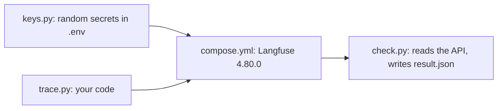

# Assignment: send one run to Langfuse

This task is optional in the live session. It is expected as homework. You work on it beside the class, while
the hand-built versions are taught.

## The task

Send one spray desk run to Langfuse, with a score. Langfuse is an open-source trace store. You run your own
copy from `compose.yml` in this folder. Everything you need is in this repo.



Work through these steps:

1. Write your secrets. Nothing is printed:

```bash
uv run python assignment/keys.py
```

Expect: `Wrote 11 secrets to` the path of `assignment/.env`.

2. Start the stack and wait until it is healthy:

```bash
docker compose --env-file assignment/.env -f assignment/compose.yml up -d --wait
```

Expect: six containers reach `Healthy`.

3. Finish `trace.py`, then run it:

```bash
uv run --group assignment --env-file assignment/.env python assignment/trace.py
```

Expect: `Sent trace` with an id and `40 model calls.` The starter prints `trace.py is not written yet`.

4. Run the check:

```bash
uv run --env-file assignment/.env python assignment/check.py
```

Expect: three `PASS` lines and `Done. Langfuse 4.80.0.` It writes `assignment/result.json`.

5. Stop the stack and delete its data when you finish:

```bash
docker compose --env-file assignment/.env -f assignment/compose.yml down -v
```

Expect: the containers and volumes are removed.

## Done when

The script checks these lines. Each one is `pass` or `fail` in `result.json`.

- The Langfuse health endpoint returns 200.
- One trace exists with a model name and token counts.
- The trace has a score named for a number the scorer reports.

## Rubric

A person reads these lines. There are no points.

- The score equals what your hand-built scorer gave for that run.
- No key is committed.
- `CHOICE.md` says when you would pick Phoenix instead, and what it costs you.

## Hand it in

Push a branch named `assignment`. Submit its URL. The grader reruns `check.py` on your branch.
