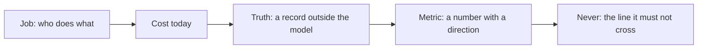

# Name the job

## The problem

"Can AI read these spray emails?" is not a question anyone can answer. A job needs two things first. It
needs a truth outside the model: a record of the right answers. And it needs a metric: a number with a
direction, such as "at least 60%". Without them, every demo looks fine. Nobody can say if the system is wrong
one time in ten or one time in a thousand.

The desk also has one rule it will never bend. Nothing goes on a crop above the label rate.

## Your challenge

Write the spray desk's job in `brief.md` in this folder, in your own words. First, read
`worlds/tallgrass_bend/brief.md` and `worlds/tallgrass_bend/seed.json`.

For example, here are two ways to write the Metric:

- "Book as many requests as we can, as accurately as we can". This has no number, so the check fails it.
- "At least 60% of requests booked with no person, with zero booked jobs that differ from the desk's records".
  This has a number and a direction, so it passes.



## Done when

- `brief.md` has the sections Job, Cost today, Truth, Metric and Never, each written in your own words.
- The Metric has a number and a direction, such as "at least" or "zero".
- The Truth names the desk's records file, `truth/dev.jsonl`.
- The Never line is about the product label.

```bash
bun run verify name-the-job
```

Expect: `Done. All 4 rules pass.`

## If you get stuck

- A metric with no number, such as "as accurate as we can", can never fail. So it cannot guide you.
- Pick a metric that counts what the business gets: a request booked right with no person. A wrong booking
  should count against you more than a request sent to a person.
- Open `seed.json` and find `max_rate_l_per_ha` and `crops`. Together, they are the label. For example,
  Podshield has `"max_rate_l_per_ha": 0.5` and `"crops": ["lentils", "peas"]`.

## Words you will use

- **Truth:** the right answer, recorded by people, that the model never sees.
- **Metric:** one number you will move, with the direction that counts as better.
- **Label rate:** the highest rate the product's legal label allows. It is in litres per hectare (L/ha).
