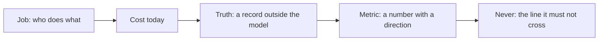

# Name the job

## The problem

"Can AI read these spray emails?" is not a question anyone can answer. Until the job has a truth outside the
model and a number with a direction, every demo looks fine and nobody can say whether the system is wrong one
time in ten or one time in a thousand. The desk also has one rule it will not bend: nothing goes on a crop
above the label rate.

## Your challenge

Write the spray desk's job in `brief.md` in this folder, in your own words. Read
`worlds/tallgrass_bend/brief.md` and `worlds/tallgrass_bend/seed.json` first.



## Done when

- `brief.md` has the sections Job, Cost today, Truth, Metric and Never, each written in your own words.
- The Metric has a number and a direction, such as "at least" or "zero".
- The Truth names the desk's records file, `truth/dev.jsonl`.
- The Never line is about the product label.

```bash
bun run verify name-the-job
```

Expect: `Done. All 4 rules pass.`

## If you get stuck

- A metric with no number, such as "as accurate as we can", cannot fail, so it cannot guide you.
- Pick a metric that counts what the business gets: a request booked right with no person. A wrong booking
  should count against you more than a request sent to a person.
- Open `seed.json` and find `max_rate_l_per_ha` and `crops`. That is the label.

## Words you will use

- **Truth:** the right answer, recorded by people, that the model never sees.
- **Metric:** one number you will move, with the direction that counts as better.
- **Label rate:** the highest rate the product's legal label allows, in litres per hectare.
