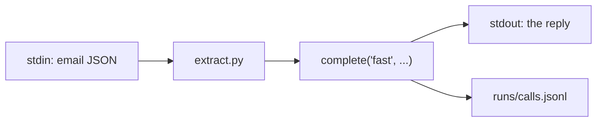

# Call the model

## The problem

Before you can check how well a model reads, you need it to read one email when you ask. You also need to
know what each call cost. Teams often call a model in five different ways, each with its own key handling and
no log. Then the bill comes, and nobody can explain it.

## Your challenge

Finish `extract.py` in this folder. It reads one email as JSON on stdin and prints what the model read.
Call the model through the course's one shared layer:

```python
from config.llm import complete

reply = complete("fast", [{"role": "user", "content": "..."}])
print(reply.text)
```

`complete` asks for a role, never a model name. It writes a line for every call to `calls.jsonl`. On replay,
it needs the whole email text in your prompt. `contract.toml` already names the verb that the check runs.



Try it on one email. The world's helper sends the email to stdin:

```bash
uv run world email TB-1001 | uv run python extract.py
```

Expect: a reply that names Old Yard, Podshield and 0.38 L/ha, inside some friendly prose.

For example, on replay the reply starts with `Here is what I found in the email:`. Then comes a JSON block with
`"field": "Old Yard"`, `"product": "Podshield"` and `"rate": "0.38 L/ha"`. It ends with
`Let me know if you need anything else.` A person can read this. A program cannot use it yet. You fix that in
the next step.

Each call also adds one line to `runs/calls.jsonl`, such as:
`{"role": "fast", "provider": "replay", "input_tokens": 56, "output_tokens": 48, "cost_usd": 1.352e-05}`. Your
token count may differ a little, because it depends on your prompt.

## Done when

- `contract.toml` names an `extract` verb.
- `extract` exits 0 and prints the reply for 3 dev emails.
- Each run made one model call through `config.llm`, logged in `calls.jsonl`.

```bash
bun run verify call-the-model
```

Expect: `Done. All 3 rules pass.`

## If you get stuck

- Put `email["text"]` inside your message. Replay looks for the whole email in the prompt.
- A hand-written answer can look right and still fail. The check counts logged calls, not text.

## Words you will use

- **Role:** what a call is for (`fast`, `smart`, `judge`). `config/models.py` maps each role to a model.
- **Provider:** who serves the model. `LLM_PROVIDER` picks one. The default is `replay`.
- **Verb:** a command named in `contract.toml`. Checks run verbs, so you can pass in any language.
