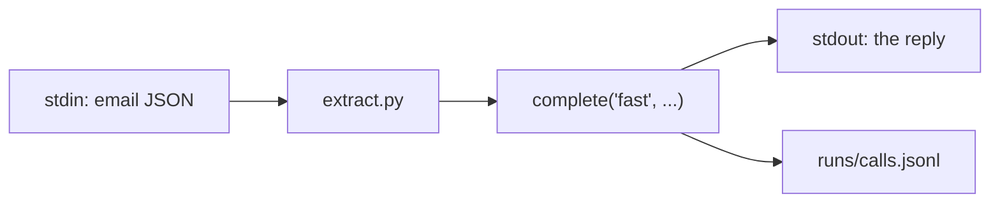

# Call the model

## The problem

Before you can check a model's reading, you need it to read one email on demand, and you need to know what
each call cost. Calls made in five different ways, each with its own key handling and no log, are how a team
ends up with a bill nobody can explain.

## Your challenge

Finish `extract.py` in this folder. It reads one email as JSON on stdin and prints what the model read.
Call the model through the course's one layer:

```python
from config.llm import complete

reply = complete("fast", [{"role": "user", "content": "..."}])
print(reply.text)
```

`complete` asks for a role, never a model name, and logs every call to `calls.jsonl`. On replay it needs the
whole email text in your prompt. `contract.toml` already names the verb the check runs.



Try it on one email, with the world's helper feeding stdin:

```bash
uv run world email TB-1001 | uv run python extract.py
```

Expect: a reply that names Old Yard, Podshield and 0.38 L/ha, inside some friendly prose.

## Done when

- `contract.toml` names an `extract` verb.
- `extract` exits 0 and prints the reply for 3 dev emails.
- Each run made one model call through `config.llm`, logged in `calls.jsonl`.

```bash
bun run verify call-the-model
```

Expect: `Done. All 3 rules pass.`

## If you get stuck

- Put `email["text"]` inside your message. Replay looks for the whole email in the prompt.
- A hand-written answer can look right and still fail: the check counts logged calls, not text.

## Words you will use

- **Role:** what a call is for (`fast`, `smart`, `judge`). `config/models.py` maps each role to a model.
- **Provider:** who serves the model. `LLM_PROVIDER` picks one; `replay` is the default.
- **Verb:** a command named in `contract.toml`. Checks run verbs, so any language passes.
