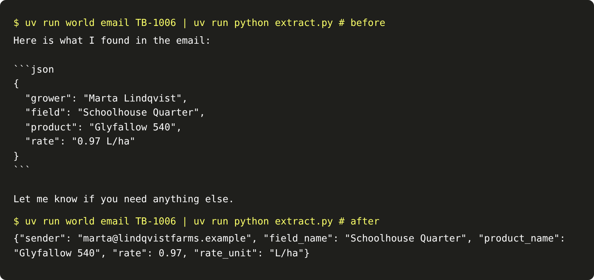

# Fix the shape

## The problem

The reply from the last step reads well to a person and is useless to a program: friendly words, JSON in a
code fence, keys nobody agreed on, and the rate as a string with its unit glued on. Cutting the JSON out of
the fence parses, but the keys and types still change from reply to reply.

## Your challenge

Change `extract.py` so it prints one bare JSON record that fits `worlds/tallgrass_bend/schema.json`. Load the
schema and pass it to the model as the shape it must return:

```python
reply = complete("fast", messages, schema=SCHEMA)
record = json.loads(reply.text)
```

A live provider enforces the schema through structured output. Replay returns the matching recorded JSON.



## Done when

- `contract.toml` names an `extract` verb.
- `extract` prints bare JSON, with no prose and no code fence, on 10 dev emails over 3 runs.
- Every record fits `schema.json`: the keys `sender`, `field_name`, `product_name`, `rate`, `rate_unit`,
  the right types, `rate_unit` one of `L/ha` or `L/acre`, and no other keys.

```bash
uv run world email TB-1006 | uv run python extract.py
```

Expect: one line of JSON with `"rate": 0.97` and `"rate_unit": "L/ha"`. Read the email: it says per acre.
The shape is right and the value is wrong. The next step catches that.

```bash
bun run verify fix-the-shape
```

Expect: `Done. All 3 rules pass.`

## If you get stuck

- Print `json.dumps(record)`, not the reply text, so nothing else reaches stdout.
- Give the model a short instruction: copy names and rates exactly as the grower wrote them.

## Words you will use

- **Schema:** a written contract for a record's keys and types. JSON Schema is the common format.
- **Structured output:** asking the provider to return only JSON that fits a schema.
- **Valid is not right:** a record can fit the schema and still be wrong. Only the truth can tell.
