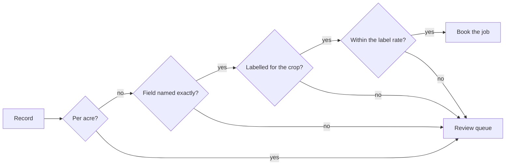
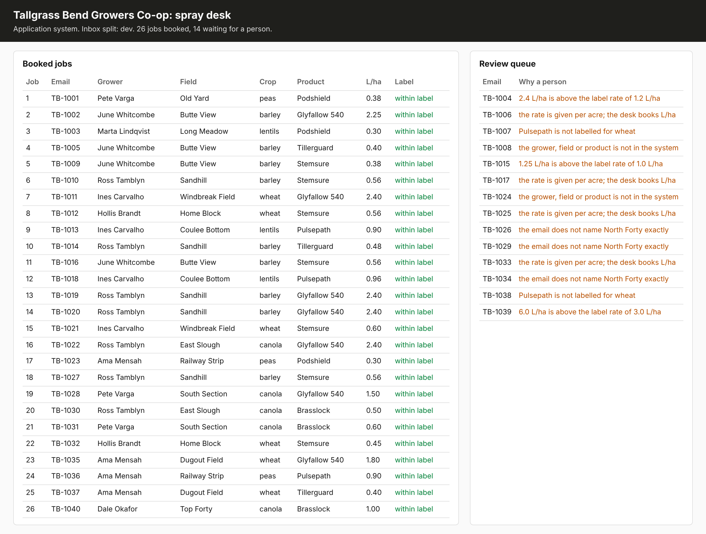

# Check against truth

## The problem

Every record now has the right shape, and some are still wrong. One grower wrote "L per acre" and the model
called it L/ha. One asked for twice the label rate. One wrote "the north block" and owns two north fields. The
application system books whatever it is sent. The model will not tell you which records are wrong, so your
code has to.

## Your challenge

`intake.py` reads every email on the desk, looks up the grower, field and product, and books the job. Its
`reasons_to_review` function returns no reasons yet, so everything is booked. Write the rules that send a
request to a person. Each rule may use only the email, the record and the application system's data, never
the desk's answers.



With `uv run world serve` running, reset and run the intake, then open http://127.0.0.1:8100:

```bash
uv run world reset && uv run python intake.py
```

Expect: one line of JSON with the count `booked` and the count sent to `review`.



## Done when

- `contract.toml` names an `intake` verb, and it exits 0 on the dev inbox, 3 fresh runs out of 3.
- Every email ends up booked or with a person, once each.
- Zero booked jobs differ from the desk's records, and zero are off label.
- At least 60% of emails are booked correctly with no person.

```bash
bun run verify check-against-truth
```

Expect: `Done. All 6 rules pass.`

## If you get stuck

- Look at the board's `OFF LABEL` rows first, then compare a booked job with its email.
- A rule that only checks the rate misses the acre emails: their wrong number is under the label.
- Sending everything to a person is safe and fails the 60% rule. Aim for both.

## Words you will use

- **Business rule:** a check the business would make by hand, written as code.
- **Auto-accepted:** booked with no person. Wrong ones cost the most.
- **Review queue:** where unsure requests go. Each one costs a person's time, so the queue is a cost too.
