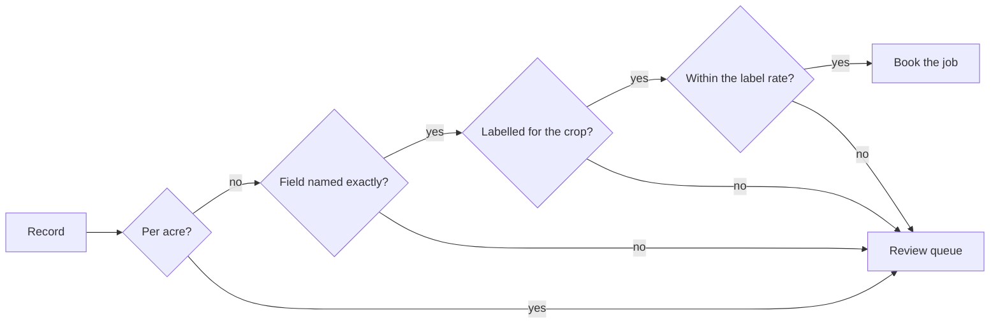

# Check against truth

## The problem

Every record now has the right shape, but some are still wrong. Here are three of them:

- One grower wrote "L per acre", and the model called it L/ha.
- One grower asked for twice the label rate.
- One grower wrote "the north block", and that grower owns two fields with "North" in the name.

The application system books whatever it gets. The model does not tell you which records are wrong. So your
code has to find them.

## Your challenge

`intake.py` reads every email on the desk. It looks up the grower, the field and the product, and it books
the job. Its `reasons_to_review` function returns no reasons yet, so it books almost every email. Write the rules
that send a request to a person.

Each rule may use only three things: the email, the record and the application system's data. A rule must
never use the desk's answers.

For example, `worlds/tallgrass_bend/inbox/dev/TB-1004.txt` asks for Pulsepath on Coulee Bottom at 2.4 L/ha. In
`seed.json`, Pulsepath has `"max_rate_l_per_ha": 1.2`. After a run of the starter code, `/api/jobs` holds a job for
TB-1004 with `"rate_l_per_ha": 2.4`. That is twice the label. A rule that compares the rate with the label sends this email to a
person instead.



Keep `uv run world serve` running. Reset the system and run the intake. Then open http://127.0.0.1:8100:

```bash
uv run world reset && uv run python intake.py
```

Expect: one line of JSON with the count `booked` and the count sent to `review`.

For example, the starter code prints `{"booked": 38, "review": 2}`: it books almost everything. The sample
solution prints `{"booked": 26, "review": 14}`.


## Done when

- `contract.toml` names an `intake` verb, and it exits 0 on the dev inbox, 3 fresh runs out of 3.
- Every email ends up booked or with a person, once each.
- Zero booked jobs differ from the desk's records, and zero are off label.
- At least 60% of emails are booked correctly with no person.

```bash
bun run verify check-against-truth
```

Expect: `Done. All 6 rules pass.`

## If you get stuck

- Look at the board's "Breaks the label" rows first. Then compare a booked job with its email.
- A rule that only checks the rate misses the acre emails. Their wrong number is under the label. For example,
  TB-1006 is booked at 0.97, and the label for Glyfallow 540 allows 3.0.
- Sending everything to a person is safe, but it fails the 60% rule. Aim for both.

## Words you will use

- **Business rule:** a check the business would make by hand, written as code.
- **Auto-accepted:** booked with no person. A wrong one costs the most.
- **Review queue:** where unsure requests go. Each one takes a person's time, so the queue is a cost too.
