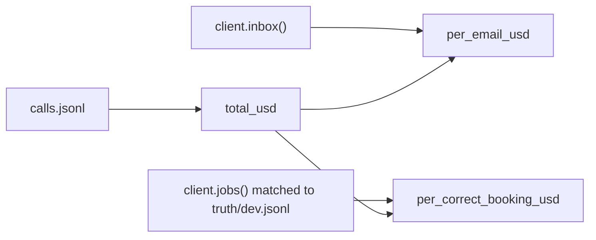

# Count the cost

## The problem

The intake works. Now the co-op asks what it costs. Cost per call is easy and misleading: a request that went
to a person still cost a call and saved nothing. The number that matters is the cost per job booked right.

## Your challenge

Finish `cost.py`. After an intake run it prints three numbers as JSON: the total, the cost per email, and the
cost per correct booking. Read the calls from `$RUNS_DIR/calls.jsonl` (default `runs/`), the inbox and jobs
from the application system, and the desk's records from `truth/dev.jsonl`.



```bash
uv run world reset && rm -rf runs && uv run python intake.py && uv run python cost.py
```

Expect: the intake counts, then one line of JSON with `total_usd`, `per_email_usd` and `per_correct_booking_usd`.

## Done when

- `contract.toml` names a `cost` verb, and after an intake run it prints the three numbers as JSON.
- `total_usd` matches the sum of `calls.jsonl`.
- `per_email_usd` is the total divided by the emails in the inbox.
- `per_correct_booking_usd` is the total divided by the jobs that match the desk's records.

```bash
bun run verify count-the-cost
```

Expect: `Done. All 5 rules pass.`

## If you get stuck

- `calls.jsonl` grows with every run. Delete `runs/` before a run you want to price.
- Replay prices its recorded tokens at a real fast model's list price, so the numbers have a real size.

## Words you will use

- **Cost per outcome:** what one useful result cost, here one job booked right.
- **Token:** the unit a model reads and writes; providers bill per million.
