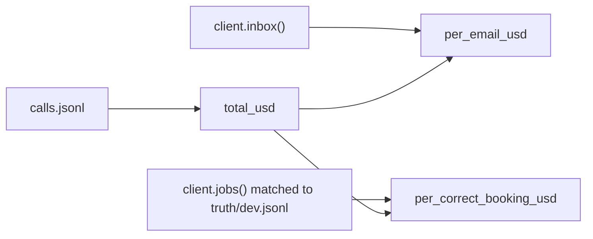

# Count the cost

## The problem

The intake works. Now the co-op asks what it costs. The cost per call is easy to find, but it misleads you. A
request that went to a person still cost a call, and it saved no work. The number that matters is the cost per
job booked right.

## Your challenge

Finish `cost.py`. After an intake run, it prints three numbers as JSON: the total, the cost per email, and the
cost per correct booking. It reads from three places:

- the calls, from `$RUNS_DIR/calls.jsonl` (the default folder is `runs/`)
- the inbox and the jobs, from the application system
- the desk's records, from `truth/dev.jsonl`



```bash
uv run world reset && rm -rf runs && uv run python intake.py && uv run python cost.py
```

Expect: the intake counts, then one line of JSON with `total_usd`, `per_email_usd` and `per_correct_booking_usd`.

For example, the sample solution prints `{"booked": 26, "review": 14}`. Then it prints a total of about
$0.000616 for 40 calls. That is about $0.0000154 per email. Only 26 jobs match the desk's records, so each
correct booking costs about $0.0000237. The cost per correct booking is always the higher number.

Python prints very small numbers in a short form. For example, `1.5408250000000003e-05` means
0.0000154: move the dot five places to the left. The long tail of digits is normal rounding in a computer.

## Done when

- `contract.toml` names a `cost` verb, and after an intake run it prints the three numbers as JSON.
- `total_usd` matches the sum of `calls.jsonl`.
- `per_email_usd` is the total divided by the emails in the inbox.
- `per_correct_booking_usd` is the total divided by the jobs that match the desk's records.

```bash
bun run verify count-the-cost
```

Expect: `Done. All 5 rules pass.`

## If you get stuck

- `calls.jsonl` grows with every run. Delete `runs/` before a run you want to price.
- Replay prices its recorded tokens at the list price of a real fast model. So the numbers are the right size.

## Words you will use

- **Cost per outcome:** what one useful result cost, here one job booked right.
- **Token:** the unit a model reads and writes, about one short word. Providers charge per million tokens.
