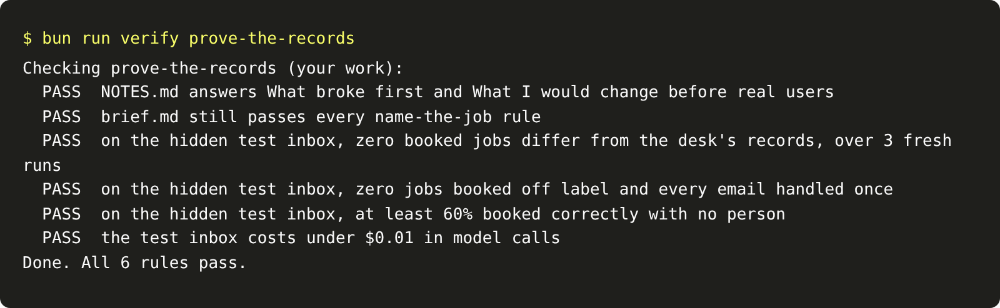

# Prove the records

## The problem

So far, everything ran on the 40 dev emails. You read those emails while you wrote your rules. A system built
from the emails it is tested on can look perfect, and then fail on the next email. The proof is a run on emails
you have not seen. It is scored against answers you cannot read.

For example, a rule could say "send TB-1006 to a person". It would pass on dev, because TB-1006 is an acre
email. But the test inbox has different emails, so that rule catches nothing there. A rule that looks for the
word "acre" in the email text works on both.

## Your challenge

Run your intake on the hidden test inbox. It has 20 emails in `worlds/tallgrass_bend/inbox/test/`. The check
scores them against hashes of the desk's records. A hash is a scrambled code: the check can compare with it,
but you cannot read the answer from it.

Then write `NOTES.md` from your own runs. Also copy your `brief.md` from `name-the-job` into this folder. This
step is a milestone, so it runs the `name-the-job` rules again.

```bash
uv run world serve --split test
```

Expect: `The spray desk is open at http://127.0.0.1:8100 (test inbox). Stop it with Ctrl+C.`



## Done when

- `NOTES.md` answers What broke first and What I would change before real users, from your own runs.
- `brief.md` still passes every `name-the-job` rule.
- On the hidden test inbox, over 3 fresh runs: zero booked jobs differ from the desk's records, zero are
  off label, every email is handled once, and at least 60% are booked correctly with no person.
- The test inbox costs under $0.01 in model calls.

```bash
bun run verify prove-the-records
```

Expect: `Done. All 6 rules pass.`

## If you get stuck

- A rule that looks up dev email ids or dev answers passes on dev and fails here. Your rules must read the
  email.
- The test run may book something wrong. If it does, find the trap it belongs to in the world's brief. Then
  fix the rule.

## Words you will use

- **Dev split:** the examples you look at while building.
- **Test split:** examples kept apart to measure the finished system. Here, the answers are stored as hashes.
- **Milestone:** a step that proves a whole part and reruns the earlier rules.
