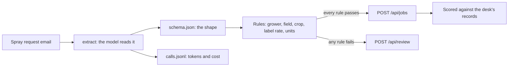

# Get records you can trust

## The problem

At Tallgrass Bend, a person types in every spray request by hand. The desk checks each rate against the
product label from memory. The label is the legal limit for a product: the highest rate, and the crops it may
go on.

A model can read the email in a second. But its first reply is friendly text with the JSON inside a code
fence. And when a grower writes "L per acre", the model often reports the number as litres per hectare. It gives no
warning. The application system books whatever it gets. One wrong rate puts too much product on a crop.

For example, `worlds/tallgrass_bend/inbox/dev/TB-1006.txt` asks for Glyfallow 540 "at 0.97 L per acre". The
model reads it as `"rate": 0.97` and `"rate_unit": "L/ha"`. The desk's own record books 2.4 L/ha. The model's
number is less than half the right amount, and nothing in its reply shows it.

## Why it matters

Turning documents into records is where most teams start with models. The result is only worth what you can
check. EvenUp is a company that drafts legal demands from medical records. Anthropic's case study on EvenUp
says its system "Increased accuracy on past medical expense totals by 14% on smaller cases". This is a
vendor's claim about its own customer
([Anthropic, EvenUp case study](https://www.anthropic.com/customers/evenup)). A number like that exists only
because someone compared the totals with a record of the right answer. In this part, you build that
comparison.

## What you build



By the end of this part, line 1 of the scorecard is yours. Your system meets three goals on emails your
rules have never seen:

- It books at least 60% of requests with no person.
- It books zero jobs wrong.
- The whole run costs less than a cent.

## The lab to run first

[Extract Structured Data with LLMs](https://github.com/learnwithparam/live-labs/tree/main/labs/01-structured-output)
(live-labs `labs/01-structured-output`, about 20 minutes). The lab uses a different world: it matches
receipts to card charges. But the pattern is the same. You use typed fields. You check them against a record
the model did not write. And you send unsure cases to a queue for a person. Optional:
[Process a Million Prompts with Batch APIs](https://github.com/learnwithparam/live-labs/tree/main/labs/03-batch-prompts).

## Steps

| Step                                                            | Minutes | You produce                                | The check reads                                |
| --------------------------------------------------------------- | ------- | ------------------------------------------ | ---------------------------------------------- |
| [name-the-job](01-name-the-job/problem/README.md)               | 15      | `brief.md`                                 | The five sections, a number in the metric      |
| [call-the-model](02-call-the-model/problem/README.md)           | 20      | An `extract` verb                          | Exit codes and `calls.jsonl`                   |
| [fix-the-shape](03-fix-the-shape/problem/README.md)             | 30      | JSON that fits `schema.json`               | Each record against the schema, over 3 runs    |
| [check-against-truth](04-check-against-truth/problem/README.md) | 30      | An `intake` verb with rules                | The application system's jobs and review queue |
| [count-the-cost](05-count-the-cost/problem/README.md)           | 15      | A `cost` verb                              | `calls.jsonl` and the jobs that match the desk |
| [prove-the-records](06-prove-the-records/problem/README.md)     | 20      | `NOTES.md`, a run on the hidden test inbox | The test split's hashes and cost               |

You work in each step's `problem/` folder. That folder starts from the answer to the step before it. So you
can start any step fresh.

## Walkthrough

Start the application system in a second terminal. Leave it running while you work:

```bash
uv run world serve
```

Expect: `The spray desk is open at http://127.0.0.1:8100 (dev inbox). Stop it with Ctrl+C.`

You can check one step at any time:

```bash
bun run verify name-the-job
```

Expect: four `FAIL` lines with `Try next:` until you write `brief.md`, then `Done. All 4 rules pass.`

You can also check the whole part:

```bash
bun run verify part get-records-you-can-trust
```

Expect: one line per step, then `Part get-records-you-can-trust is done: 6/6 steps pass.` once every step passes.

## Go further

These ideas are for when every step passes. Each one keeps the same check, so you can measure if it helps.

- **Convert acre rates yourself.** One hectare is about 2.471 acres. So 0.97 L per acre is about 2.4 L per
  hectare, which is the desk's own record for TB-1006. Convert the rate in code, not in the model. Then run
  `bun run verify check-against-truth` and see if more emails are booked right with zero booked wrong.
- **Run on a live model.** Set `LLM_PROVIDER` in `.env` and run the intake three times. Replay gives the
  same answer every time. A live model may not. Count how many records change between runs.
- **Pay less for the same work.** The optional
  [batch lab](https://github.com/learnwithparam/live-labs/tree/main/labs/03-batch-prompts) sends many prompts
  in one batch. Price your intake with and without it, using your `cost` verb.
