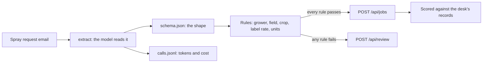

# Get records you can trust

## The problem

At Tallgrass Bend every spray request is typed in by hand, and the desk checks each rate against the product
label from memory. A model can read the email in a second. But its first reply is chatty prose with JSON in a
code fence, and when a grower writes "L per acre" it happily reports the number as litres per hectare. The
application system books whatever it is sent. One wrong rate puts too much product on a crop.

## Why it matters

Reading documents into records is where most teams start with models, and the result is only worth what you
can check. Anthropic's case study on EvenUp, which drafts legal demands from medical records, reports that its
system "Increased accuracy on past medical expense totals by 14% on smaller cases"
([Anthropic, EvenUp case study](https://www.anthropic.com/customers/evenup), a vendor's claim about its
customer). A number like that exists only because someone compared the extracted totals with a record of the
right answer. That comparison is what you build here.

## What you build



By the end, line 1 of the scorecard is yours: at least 60% of requests booked with no person, zero booked
wrong, on emails your rules have never seen, for less than a cent.

## The lab to run first

[Extract Structured Data with LLMs](https://github.com/learnwithparam/live-labs/tree/main/labs/01-structured-output)
(live-labs `labs/01-structured-output`, about 20 minutes). Its world is different, receipts matched to card
charges, and the pattern is the same: typed fields, a check against a record the model did not write, and a
queue for a person. Optional: [Process a Million Prompts with Batch APIs](https://github.com/learnwithparam/live-labs/tree/main/labs/03-batch-prompts).

## Steps

| Step | Minutes | You produce | The check reads |
|---|---|---|---|
| [name-the-job](01-name-the-job/problem/README.md) | 15 | `brief.md` | The five sections, a number in the metric |
| [call-the-model](02-call-the-model/problem/README.md) | 20 | An `extract` verb | Exit codes and `calls.jsonl` |
| [fix-the-shape](03-fix-the-shape/problem/README.md) | 30 | JSON that fits `schema.json` | Each record against the schema, over 3 runs |
| [check-against-truth](04-check-against-truth/problem/README.md) | 30 | An `intake` verb with rules | The application system's jobs and review queue |
| [count-the-cost](05-count-the-cost/problem/README.md) | 15 | A `cost` verb | `calls.jsonl` and the jobs that match the desk |
| [prove-the-records](06-prove-the-records/problem/README.md) | 20 | `NOTES.md`, a run on the hidden test inbox | The test split's hashes and cost |

Each step's `problem/` folder is where you work. It starts from the previous step's answer, so you can begin
any step fresh.

## Walkthrough

Start the application system in a second terminal and leave it running while you work:

```bash
uv run world serve
```

Expect: `The spray desk is open at http://127.0.0.1:8100 (dev inbox). Stop it with Ctrl+C.`

Check one step at any time:

```bash
bun run verify name-the-job
```

Expect: four `FAIL` lines with `Try next:` until you write `brief.md`, then `Done. All 4 rules pass.`

Check the whole part:

```bash
bun run verify part get-records-you-can-trust
```

Expect: one line per step, then `Part get-records-you-can-trust is done: 6/6 steps pass.` once every step passes.
