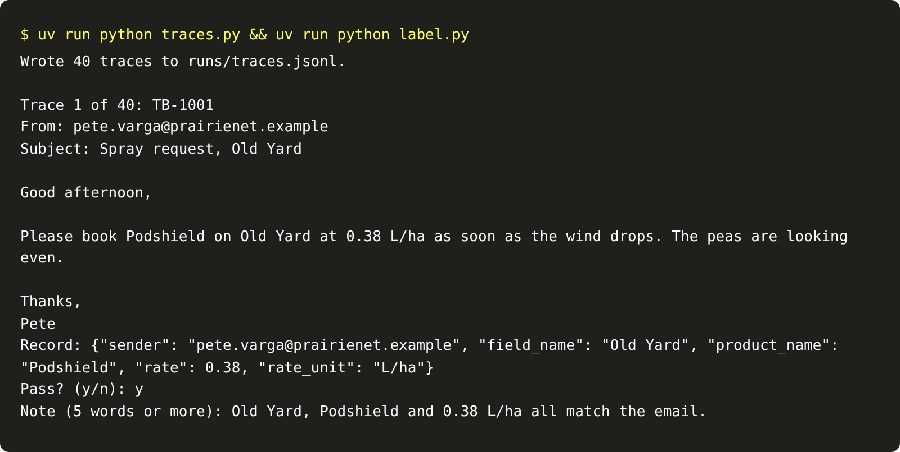

# Read the traces

## The problem

Part one proved your system on one run. But you only looked at the score. You never read what the model wrote
for each email. Teams that skip this step write tests for problems they imagine, and miss the ones they have.

A trace is the record of one run: what went in and what came out. Reading traces is how you find out what
really goes wrong. You read first, and you name the problems later.

## Your challenge

Save a trace for every dev email. Then read each one and label it pass or fail, with a note in your own words.
Do not pick categories yet. A category chosen before you read hides what you did not expect.

```bash
uv run python traces.py
```

Expect: `Wrote 40 traces to runs/traces.jsonl.`

```bash
uv run python label.py
```

Expect: `Trace 1 of 40: TB-1001`, the email, the record, then `Pass? (y/n):`.

`label.py` adds one line to `evals/labels.jsonl` for each answer. You can stop with Ctrl+C and go on later.

For example, trace TB-1017 shows an email that says "0.24 L per acre". The record says `"rate": 0.24` and
`"rate_unit": "L/ha"`. That is a fail. A good note says what you saw:

```json
{
  "email_id": "TB-1017",
  "pass": false,
  "note": "The email says 0.24 L per acre, but the record calls it L/ha."
}
```

TB-1004 asks for Pulsepath at 2.4 L/ha, twice the label rate. The record copies the email correctly, so the
record itself passes. Part one's rules stop the booking. Write that in the note.



## Done when

- `evals/labels.jsonl` has 30 rows or more, each for a different dev email.
- Each row has `pass` set to true or false, and a note of 5 words or more.
- Rows hold only `email_id`, `pass` and `note`. No category.
- At least 5 rows are fails, and 90% of your labels agree with the desk's records.

```bash
bun run verify read-the-traces
```

Expect: `Done. All 6 rules pass.`

## If you get stuck

- Read the email first, then the record. Check each of the five fields against the words in the email.
- A record can be right while the request is wrong. Label the record, and say the rest in the note.
- If you label everything pass, the check fails. Look again at rates, units and names.

## Words you will use

- **Trace:** what went into one run and what came out of it.
- **Label:** a person's pass or fail on one trace.
- **Open note:** a note in your own words, written before you have categories.
