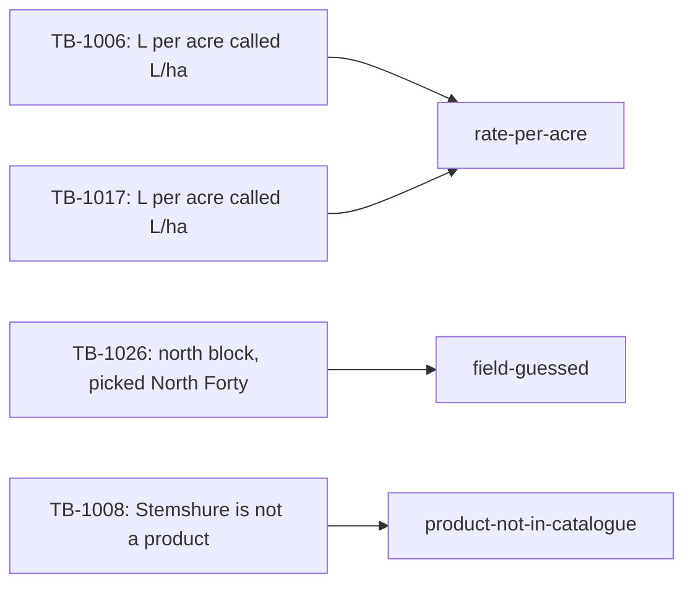

# Name the failures

## The problem

You now have a list of failed traces, each with a note. A list is hard to act on. You cannot test "40 notes".
You need to know which problems happen most, so you fix the big ones first.

## Your challenge

Read the notes on your failed labels. Group the ones that share one cause into a failure mode. Write each mode
in `evals/failure-modes.md`, with a definition, a count and the emails in it.



Each mode is one block like this one. The heading is the mode's name, in lower case words joined by dashes:

```markdown
## rate-per-acre

Definition: The grower writes the rate per acre, and the record gives the same number with the unit L/ha.
Count: 4
Emails: TB-1006, TB-1017, TB-1025, TB-1033
```

For example, TB-1026 and TB-1029 both come from Hollis, who writes "the north block". Hollis owns North Forty
and North Flats, and both records say North Forty. The cause is the same, so they share one mode.

Every failed label goes into exactly one mode. If a trace fits two modes, pick the cause that comes first.

To list your failed labels:

```bash
grep '"pass": false' evals/labels.jsonl
```

Expect: one line for each trace you labelled as a fail.

## Done when

- `evals/failure-modes.md` names 3 modes or more.
- Each mode has a Definition of 5 words or more, a Count and its Emails.
- Each Count equals the number of emails listed under it.
- Every failed label sits in exactly one mode, and every listed email is a failed label.

```bash
bun run verify name-the-failures
```

Expect: `Done. All 5 rules pass.`

## If you get stuck

- Start with the note you wrote most often. That is your biggest mode.
- A mode is a cause, not a field. "Wrong rate" is too wide. "Rate per acre read as L/ha" names the cause.
- Count again after each change. The check compares your counts with your labels.

## Words you will use

- **Failure mode:** one cause of failure, such as reading a rate per acre as L/ha.
- **Definition:** one sentence that lets someone else put a new trace in the right mode.
