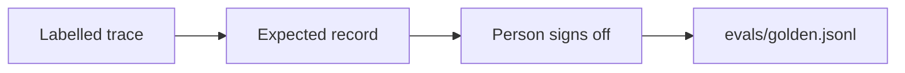

# Build the golden set

## The problem

Your labels say which records were wrong. They do not say what the right record is. Without the right answer,
no code can check a new run. You would have to read every trace again after every change.

## Your challenge

Write `evals/golden.jsonl`: cases with the record the system should return, signed off by a person. Each line
is one case. Cover every failure mode with 2 cases or more, and add clean cases too.



For example, here is the case for TB-1017. The email says "0.24 L per acre". So the right record keeps the
number and says `L/acre`:

```json
{
  "email_id": "TB-1017",
  "mode": "rate-per-acre",
  "expected": {
    "sender": "ines.carvalho@ridgemail.example",
    "field_name": "Windbreak Field",
    "product_name": "Tillerguard",
    "rate": 0.24,
    "rate_unit": "L/acre"
  },
  "signed_off_by": "Noor Haddad, spray desk"
}
```

Write what the record should say, never what the model said. For a misspelled product, the expected record
names the real product, such as Stemsure for "Stemshure". For "the north block", it keeps the grower's own
words.

Use `clean` as the mode for a case with no failure. Put a real person's name in `signed_off_by`. Use your own
name if you checked the case yourself. The desk's records in `worlds/tallgrass_bend/truth/dev.jsonl` help you
check your work. They use ids, such as `"product_code": "P140"`. Find the names for those ids in
`worlds/tallgrass_bend/seed.json`. Count your cases:

```bash
wc -l evals/golden.jsonl
```

Expect: `27 evals/golden.jsonl` or another number of 25 or more.

## Done when

- `evals/golden.jsonl` has 25 cases or more, each on a different dev email.
- Every expected record fits `worlds/tallgrass_bend/schema.json`.
- Every case has `signed_off_by` with a person's name.
- Every failure mode has 2 cases or more, and every case names a mode or `clean`.
- Every expected record agrees with the desk's records.

```bash
bun run verify build-the-golden-set
```

Expect: `Done. All 5 rules pass.`

## If you get stuck

- Start from the traces. Run `uv run python traces.py` in this folder to write `runs/traces.jsonl`. Copy each
  record, then fix what your label said was wrong.
- Copy mode names from `evals/failure-modes.md` exactly.
- The agreement rule converts L/acre to L/ha before it compares the rate with the desk's record.

## Words you will use

- **Golden set:** cases whose right answers a person has checked and signed off.
- **Expected record:** what the system should return for that email.
- **Sign-off:** a named person saying "this answer is right".
