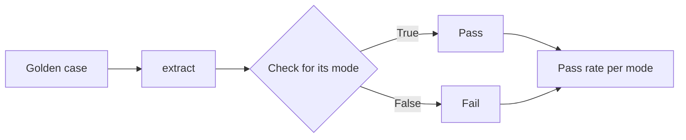

# Write a code check

## The problem

The golden set says what each record should be. Now something must compare the model's records with it, every
time the code changes. A person cannot do that by hand. Most failure modes are simple enough for code to check.
Code is fast, free and gives the same answer every time.

## Your challenge

`eval.py` runs every golden case through `extract` and looks up a check for the case's mode. `CODE_CHECKS` is
empty, so every pass rate is `null`. Write one check for `clean` and one for each failure mode that code can
judge. Leave at most one mode for a judge, in the next step.

Each check takes two records and returns True when the model's record passes:

```python
def has_the_right_unit(record: dict, expected: dict) -> bool:
    """rate-per-acre: the number and its unit are both right."""
    return record["rate_unit"] == expected["rate_unit"] and same_rate(record, expected)
```



For example, `product-not-in-catalogue` needs no expected record at all. The record passes when its
`product_name` is one of the six names in `worlds/tallgrass_bend/seed.json`. "Stemshure" is not, so TB-1008
fails.

```bash
uv run python eval.py
```

Expect: `{"pass_rate_by_mode": {"clean": 1.0, "rate-per-acre": 0.0, "product-not-in-catalogue": 0.0, "field-guessed": null}, "cases": 27}`

The failure modes pass 0% of their cases. That is right: those are the cases you labelled as fails. The eval
measures today's system. It does not fix it.

## Done when

- `contract.toml` names an `eval` verb, and it exits 0 and prints `pass_rate_by_mode` as JSON.
- The eval makes one model call for each golden case.
- Every mode gets a pass rate from 0 to 1, except at most one left for a judge.
- Your checks agree with your labels: `clean` passes every case, and each failure mode fails most of its cases.

```bash
bun run verify write-a-code-check
```

Expect: `Done. All 5 rules pass.`

## If you get stuck

- A check must look at what its mode is about. For `rate-per-acre`, the number alone is not enough.
- If `clean` is below 1.0, print the record and the expected record for a clean case and compare them.
- A reply that cannot be read already counts as a fail. Do not change that.

## Words you will use

- **Code check:** a few lines of code that pass or fail one record, the same way every time.
- **Pass rate:** the share of a mode's cases that pass, from 0 to 1.
