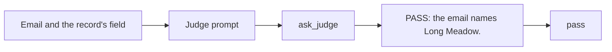

# Draft a judge

## The problem

One failure mode is hard for code. Did the grower name the field, or did the reader guess? "Schoolhouse Qtr" is
a clear name. "The north block" fits two of Hollis's fields. A word match gets both wrong. So you ask a model to
judge. A judge is a model that grades another model's work.

Many teams ask a judge for a score from 1 to 5. The judge gives almost everything a 4. A score of 4 cannot tell
your code to stop a bad record.

## Your challenge

`judge.py` asks for a score. Change it to ask for PASS or FAIL, then turn the reply into `"pass"` or `"fail"`.
Use `ask_judge` from `part_kit.py`. It calls the judge role and works on replay with no key.



The judge reads a list of cases on stdin. Try it on the 16 dev cases in the kit:

```bash
uv run python -c "import json; print(json.dumps([json.loads(line) for line in open('../../kit/judge-cases/dev.jsonl')]))" | uv run python judge.py
```

Expect: a list with one verdict for each case, such as `{"case_id": "J-D01", "verdict": "pass"}`.

For example, the starter prints `"verdict": "4"` for case J-D01. After your change, it prints
`"verdict": "pass"`. Case J-D11 says "Please book Glyfallow 540" and names no field, so it gets `"fail"`.

Your judge will still miss many fails. That is the next step's job.

## Done when

- `contract.toml` names a `judge` verb, and it gives a verdict for each of the 16 dev cases.
- Every verdict is `"pass"` or `"fail"`, never a score.
- The judge makes one call to the judge role for each case.
- The judge says pass at least once and fail at least once.

```bash
bun run verify draft-a-judge
```

Expect: `Done. All 5 rules pass.`

## If you get stuck

- Ask for the verdict first, then a reason. The first word is then easy to read.
- Turning a score into pass or fail does not help. A judge that gives every case a 4 still says pass to all.
- On replay, keep the whole email of the case in your prompt.

## Words you will use

- **Judge:** a model that grades another model's answer as pass or fail.
- **Binary verdict:** an answer with two values, pass or fail.
