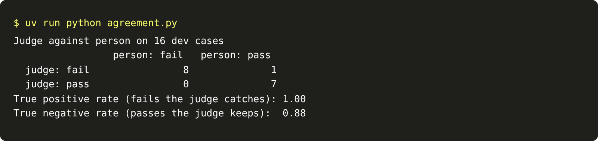

# Align the judge

## The problem

Your judge says pass or fail now. But does it agree with a person? A judge that passes every guessed field is
worse than no judge, because people trust it. You find out by scoring the judge against a person's labels.

You must score it on cases you did not tune it on. If you tune a prompt on the same cases you score, the score
only tells you that you memorised them.

## Your challenge

Tune the judge prompt on the 16 labelled dev cases until it agrees with the person. The check then scores it on
16 held-out cases. Two numbers matter:

- **True positive rate:** of the records a person failed, the share the judge also fails.
- **True negative rate:** of the records a person passed, the share the judge also passes.

```bash
uv run python agreement.py
```

Expect: a table of judge against person on 16 dev cases, then both rates.

For example, the judge from the last step passes almost everything. Its true positive rate on the dev cases is
0.25. It passes J-D09, where Hollis writes "the north block" and the record says North Forty.

Two changes help most. Say what a pass and a fail look like, using your definition in
`evals/failure-modes.md`. Then show the judge a few labelled dev cases as examples, with at least one fail. Put
the examples before the case you judge, so the case comes last.



## Done when

- The judge gives a verdict for each of the 16 held-out cases.
- On the held-out cases, the true positive rate is 0.8 or more.
- On the held-out cases, the true negative rate is 0.8 or more.
- No held-out case is used as an example in the prompt.

```bash
bun run verify align-the-judge
```

Expect: `Done. All 4 rules pass.`

## If you get stuck

- "When in doubt, fail" catches every fail, but it fails good records too. The true negative rate drops.
- Take examples only from `kit/judge-cases/dev.jsonl`. The check reads which cases went into each prompt.
- Each replay call notes its examples in `runs/calls.jsonl`, under `example_case_ids`.

## Words you will use

- **Held-out cases:** labelled cases you never tune on. You use them only to score.
- **True positive rate:** the share of real fails the judge catches.
- **True negative rate:** the share of real passes the judge keeps.
- **Few-shot examples:** labelled cases shown in the prompt, so the model sees what you mean.
