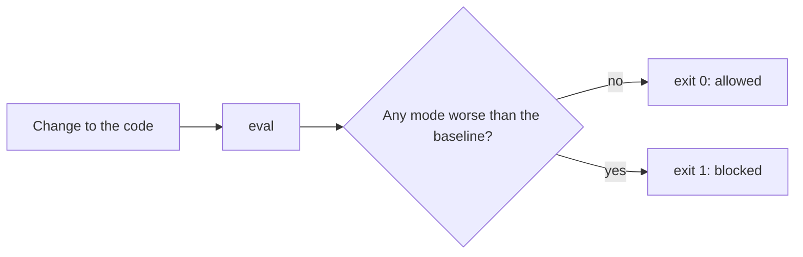

# Block a bad change

## The problem

A teammate makes the extract prompt shorter to save tokens. They also drop the schema, because "the model returns
JSON anyway". It does not. Every reply comes back as friendly prose, and no record can be read. Your eval
prints lower numbers, but it still exits 0. So nothing stops the change.

## Your challenge

`eval.py` now uses your judge for `field-guessed`. Make it save a baseline and block a change that makes any mode
worse:

- `uv run python eval.py --save-baseline` saves today's pass rates to `evals/baseline.json`.
- `uv run python eval.py` compares with the baseline. It exits 1 when any mode passes fewer cases than before.
  It lists those modes under `regressions`.



On the starter, `eval.py` does not know `--save-baseline` yet. It only prints the pass rates. After your change,
save the baseline once, from your good code. Commit the file:

```bash
uv run python eval.py --save-baseline
```

Expect: `Saved the pass rates of 4 modes to evals/baseline.json.`

```bash
uv run python eval.py
```

Expect: `{"pass_rate_by_mode": {"clean": 1.0, ...}, "cases": 27, "regressions": []}` and exit code 0.

For example, the check copies your folder and puts the teammate's change, `kit/planted/extract.py`, in place of
your `extract.py`. Then it runs your eval. A good eval prints `"regressions": ["clean"]` and exits 1.

## Done when

- `evals/baseline.json` holds a pass rate for every mode in `golden.jsonl`.
- `eval` exits 0 on your code as it is.
- `eval` exits 1 when the planted change replaces `extract.py`, and lists `clean` under `regressions`.

```bash
bun run verify block-a-bad-change
```

Expect: `Done. All 4 rules pass.`

## If you get stuck

- Compare every mode in the baseline. A mode with no rate now counts as worse.
- Do not skip a reply that cannot be read. A skipped case cannot fail, so the change looks fine.
- Never save the baseline from broken code. That makes the broken numbers the new normal.

## Words you will use

- **Baseline:** the pass rates of the version you trust, saved to compare with.
- **Regression:** a change that makes something worse that used to work.
- **Exit code:** the number a command ends with. 0 means it passed. 1 means it failed.
