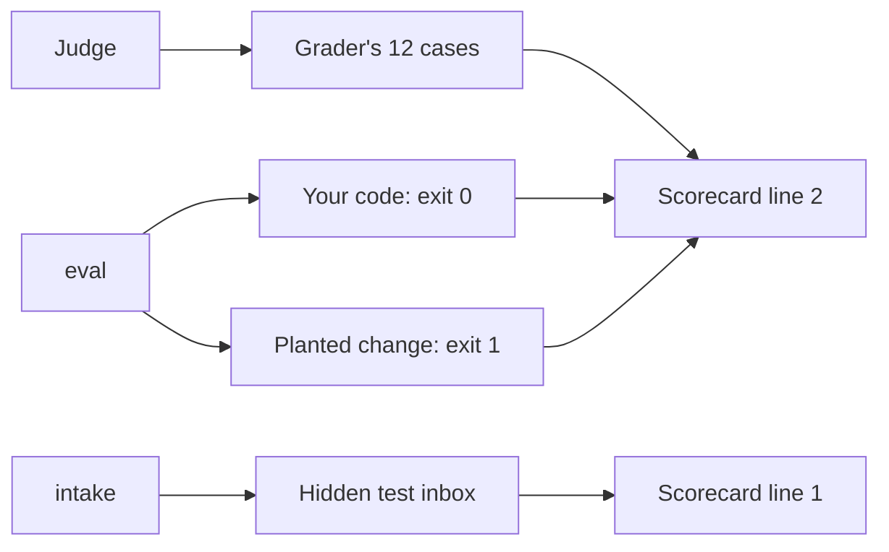
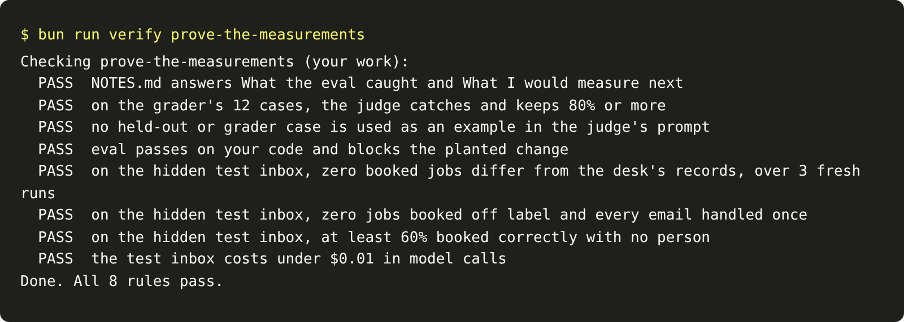

# Prove the measurements

## The problem

You built an eval, a judge and a gate. Each worked on the cases you saw. A grader now checks them on cases you
did not see. Line 2 of the scorecard is yours when your measurements hold there too, and line 1 still holds.

## Your challenge

Write two short answers in `NOTES.md`, from your own runs. Then run the milestone check. It does four things:

- It scores your judge on the grader's 12 cases. Their labels are stored as hashes, so nobody can read them.
- It checks that no held-out or grader case went into the judge's prompt.
- It runs your eval on your code, then on the planted change.
- It reruns part one's rules on the hidden test inbox, 3 fresh runs.



For example, a learner keeps the teammate's short prompt in `extract.py`. Then they save the baseline again,
so `clean` is `0.0` in `evals/baseline.json`. Now the eval passes, and the gate is open. The check catches this
in two ways. The planted change no longer makes any mode worse, so the eval does not block it. And the short
prompt fails part one's rules on the test inbox.

```bash
bun run verify prove-the-measurements
```

Expect: `Done. All 8 rules pass.`



## Done when

- `NOTES.md` answers What the eval caught and What I would measure next, in 20 words or more each.
- On the grader's 12 cases, the judge catches and keeps 80% or more.
- No held-out or grader case is used as an example in the judge's prompt.
- `eval` passes on your code and blocks the planted change.
- On the hidden test inbox, part one's rules still pass.

## If you get stuck

- If a judge rule fails, run `uv run python agreement.py` in this folder. Both rates should be 0.8 or more.
- If the eval rule fails, run `uv run python eval.py` in this folder. It should print `"regressions": []`. Your
  `evals/baseline.json` must come from good code, so `clean` is `1.0` there.
- If line 1 fails, compare your `extract.py` with the one from part one. A shorter prompt can break it.

## Words you will use

- **Milestone:** a step that proves a part on data you have not seen.
- **Scorecard line:** one result the whole course builds up, such as "the judge agrees with people".
