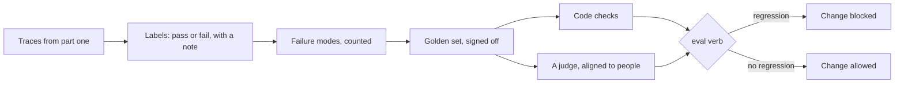

# Measure before you change

## The problem

Someone makes the extract prompt shorter to save tokens. Now a case the desk cares about starts to slip
through. It might be a rate per acre, or a product name with a spelling mistake. Nobody knows until a grower
phones about a burnt crop. Part one proved the system once. Nothing stops the next change from breaking it.

For example, `worlds/tallgrass_bend/inbox/dev/TB-1008.txt` asks for "Stemshure". The real product is called
Stemsure. Today the system finds the right product, and the desk's record books it as `P140`. After a careless
prompt change, the model might stop matching the name. In this part, you build the test that notices.

## Why it matters

One passing run proves very little. An eval is a repeatable test of a model's work. Anthropic's guide to agent
evals shows the problem with a sum: "If your agent has a 75% per-trial success rate and you run 3 trials, the
probability of passing all three is (0.75)³ ≈ 42%"
([Anthropic, Demystifying evals for AI agents](https://www.anthropic.com/engineering/demystifying-evals-for-ai-agents)).
So you measure a change over many cases and several runs. Only then can anyone call it better.

## What you build



Three new words appear here. A golden set is a list of cases whose right answers a person has signed off. A
judge is a model that grades another model's answer as pass or fail. A regression is a change that makes
something worse that used to work.

## The labs

- Core: [Test LLM Features with a Golden Dataset](https://github.com/learnwithparam/live-labs/tree/main/labs/02-golden-set) (live-labs `labs/02-golden-set`, about 20 minutes)
- Optional: [Score Risk with a Decision Model](https://github.com/learnwithparam/live-labs/tree/main/labs/19-decision-ai)

## Steps

| Step                     | Minutes | You produce                                        | Done when (what the check reads)                                                        |
| ------------------------ | ------- | -------------------------------------------------- | --------------------------------------------------------------------------------------- |
| `read-the-traces`        | 30      | `evals/labels.jsonl`, 30 or more rows              | Row count, pass or fail on each, a note of 5 or more words, no preset category          |
| `name-the-failures`      | 20      | `evals/failure-modes.md`                           | At least 3 modes, each defined and counted; every failed label maps to one mode         |
| `build-the-golden-set`   | 30      | `evals/golden.jsonl`                               | 25 or more cases, 2 or more per mode, each with an expected output and `signed_off_by`  |
| `write-a-code-check`     | 20      | A code check per mode code can judge               | `eval` prints a pass rate per mode                                                      |
| `draft-a-judge`          | 20      | A judge prompt for one mode code cannot judge      | The judge returns pass or fail on every dev label, never a score from 1 to 5            |
| `align-the-judge`        | 20      | The judge, tuned on held-out labels                | True positive and true negative rates both 0.8 or more on held-out human labels         |
| `block-a-bad-change`     | 20      | An `eval` verb that exits non-zero on a regression | A planted prompt change makes `eval` fail; the current version passes                   |
| `prove-the-measurements` | 20      | Scorecard line 2                                   | Judge agreement on the grader's labels, the planted change blocked, line 1 still passes |

The steps take 180 minutes in total. The brief planned one step, `align-a-judge`, of 40 minutes. Here it is
split into two steps: `draft-a-judge` and `align-the-judge`.

## The kit

This part adds judge cases and a planted bad change to the world. They live in [`kit/`](kit/README.md).
Your code finds them through `part_kit.py`. Messages this part can print are in
[troubleshooting.md](troubleshooting.md).

## Walkthrough

You work in each step's `problem/` folder. Run every command from there. The commands need no model key.

Save the traces, then label them:

```bash
cd parts/02-measure-before-you-change/01-read-the-traces/problem && uv run python traces.py
```

Expect: `Wrote 40 traces to runs/traces.jsonl.`

```bash
uv run python label.py
```

Expect: `Trace 1 of 40: TB-1001`, then the email, the record and `Pass? (y/n):`.

Run the eval once your code checks are written:

```bash
uv run python eval.py
```

Expect: one line of JSON with `pass_rate_by_mode`, such as `"clean": 1.0` and `"rate-per-acre": 0.0`.

Score your judge against a person on the dev cases:

```bash
uv run python agreement.py
```

Expect: a table of judge against person, then `True positive rate` and `True negative rate`.

Save the baseline from good code, then compare:

```bash
uv run python eval.py --save-baseline && uv run python eval.py
```

Expect: `Saved the pass rates of 4 modes to evals/baseline.json.` then a line with `"regressions": []`.

Check one step, or the whole part, from the repo root:

```bash
bun run verify read-the-traces
```

Expect: `FAIL` lines with `Try next:` until your labels are written, then `Done. All 6 rules pass.`

```bash
bun run verify part measure-before-you-change
```

Expect: one line per step, then `Part measure-before-you-change is done: 8/8 steps pass.` once every step passes.

## Finished

You now have a measured system. Your labels say what goes wrong, your failure modes say how often, and your
golden set says what right looks like. Code checks and an aligned judge turn that into pass rates. The eval
blocks any change that makes a mode worse. Line 2 of the scorecard is yours.

The next part, [Answer from the sources](../03-answer-from-the-sources/README.md), answers growers' questions
from the co-op's labels and guides. You measure it the same way: labelled questions first, then a number.
