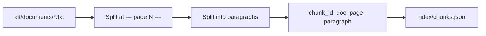

# Load the documents

## The problem

Growers ask the desk the same questions every season, and the answers are in the product labels and the
co-op's guides. A model cannot read nine documents for every question. It is slow, and it costs money. So you
cut the documents into small pieces first. Then a search can hand the model only the pieces that matter.

Each piece needs an id that never changes. A citation points to that id. If the id changes every time you
rebuild, every old citation breaks.

## Your challenge

`load.py` reads every document in `kit/documents/` and saves `index/chunks.jsonl`. Right now it makes one chunk
per document, on page 1, with a random id. Change it so that each chunk is one paragraph, on the page it really sits on. Build its id from the
document, the page and the paragraph.

Each document starts with a title line. Then each page starts with a marker line:

```text
Title: Pulsepath product label
--- page 1 ---
Pulsepath product label. Pulsepath is a herbicide for broadleaf weeds in pulse crops. Co-op code P130.
...
--- page 2 ---
Rain. The spray must stay dry on the leaf. Rainfast after 4 hours. Do not spray if rain is likely sooner.
```



For example, the rain paragraph above becomes this chunk:

```json
{
  "chunk_id": "pulsepath-label-p2-1",
  "doc_id": "pulsepath-label",
  "page": 2,
  "text": "Rain. The spray must stay dry on the leaf. ..."
}
```

```bash
uv run python load.py
```

Expect: `Saved 74 chunks to index/chunks.jsonl.` Your number may differ if you split another way.

## Done when

- `contract.toml` names a `load` verb, and it exits 0.
- Every chunk has a `chunk_id`, a `doc_id`, a `page` number and some `text`.
- Every document in `kit/documents/` has chunks.
- Each chunk is 1500 characters or fewer and sits on the page it names.
- Chunk ids are unique, and a rebuild gives the same ids.

```bash
bun run verify load-the-documents
```

Expect: `Done. All 5 rules pass.`

## If you get stuck

- Python's `re.split` with a group keeps the page numbers. `PAGE_MARKER.split(text)` gives the title, then a
  number and its page, again and again.
- Never use `uuid4()` or the time in an id. Both change on every run.

## Words you will use

- **Chunk:** a short piece of a document, such as one paragraph.
- **Index:** the saved list of chunks a search reads.
- **Stable id:** an id that is the same every time you rebuild the index.
