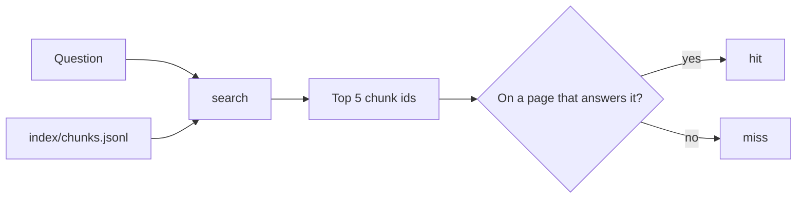
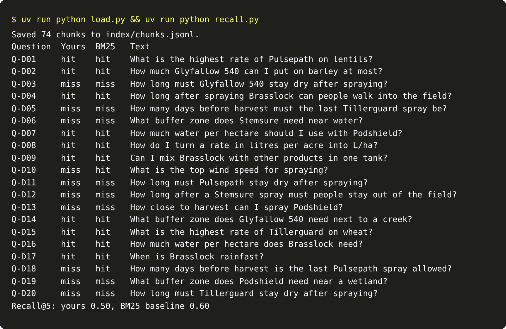

# Search the passages

## The problem

The index has 74 chunks. A question needs only the few that answer it. If the search hands the model the wrong
chunks, even a perfect model gives a wrong answer, or a made-up one. So you measure the search on its own,
before any model is involved.

Recall@5 is the measure. It is the share of questions where a chunk from the right page is in the top 5 results.

## Your challenge

`search.py` returns the first 5 chunks in the index, whatever the question. Make it rank the chunks by how well
they match the question, and return the best k ids.



A simple start works: count how many of the question's useful words each chunk shares. Leave out words such as
"the" and "how", which match almost every chunk.

```bash
echo '{"question": "What is the highest rate of Pulsepath on lentils?", "k": 5}' | uv run python search.py
```

Expect: `{"chunk_ids": [...]}` with 5 ids, starting with chunks from `pulsepath-label`.

`recall.py` runs your search on the 20 labelled dev questions in `kit/questions/dev.jsonl`:

```bash
uv run python load.py && uv run python recall.py
```

Expect: one line per question with `hit` or `miss`, then `Recall@5: yours 0.50, BM25 baseline 0.60`.

For example, Q-D11 asks "How long must Pulsepath stay dry after spraying?". The answer is on page 2 of the
Pulsepath label. Word counting misses it, because page 2 never says "Pulsepath". You fix that in the next step.



## Done when

- `contract.toml` names a `search` verb.
- For every dev question, `search` returns exactly k chunk ids that are in the index.
- Recall@5 on the dev questions is 0.4 or more.

```bash
bun run verify search-the-passages
```

Expect: `Done. All 3 rules pass.`

## If you get stuck

- Return only the top k. A list of every chunk is not a search.
- Lower case the question and the chunk before you compare words.

## Words you will use

- **Recall@5:** the share of questions with a right chunk in the top 5 results.
- **Baseline:** a plain method to compare with, so you know your change helped.
