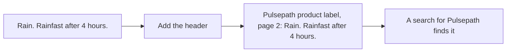

# Beat the baseline

## The problem

`recall.py` prints a BM25 baseline beside your score. BM25 is a classic word-matching search. It gives rare
words more weight than common ones. On these documents it still finds the right page for only 12 of 20 dev
questions. Most misses are about a label's second page, which never names the product.

## Your challenge

Reach recall@5 of 0.85 or more, and beat the plain BM25 baseline. Two changes do it:

- Use BM25 in `search.py`, instead of counting shared words.
- Put a short header at the start of every chunk in `load.py`: the document's title and the page.



For example, without a header the chunk `pulsepath-label-p2-1` reads "Rain. The spray must stay dry on the leaf.
Rainfast after 4 hours." The question Q-D11 says "Pulsepath", so the search ranks Pulsepath's first page higher.
With the header, the chunk says "Pulsepath product label, page 2: Rain. ..." and comes near the top.

Rebuild the index after you change `load.py`:

```bash
uv run python load.py && uv run python recall.py
```

Expect: `Recall@5: yours 1.00, BM25 baseline 0.60`, or a score of 0.85 or more for yours.

## Done when

- Recall@5 on the dev questions is 0.85 or more.
- Recall@5 on the dev questions beats the plain BM25 baseline.

```bash
bun run verify beat-the-baseline
```

Expect: `Done. All 2 rules pass.`

## If you get stuck

- BM25 with no header scores the same as the baseline. The header is what moves it.
- Keep the paragraph at the end of the chunk. The check finds each chunk on its page by its last words.
- `recall.py` shows the BM25 maths in `baseline_search`. You can start from it.

## Words you will use

- **BM25:** a word-matching search that weights rare words more and long chunks less.
- **Chunk header:** text at the start of a chunk that says where it comes from.
