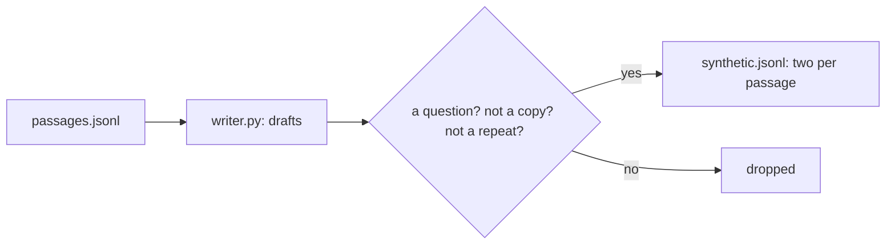

# Write synthetic questions

## The problem

You have four passages and one real question. Too few to tell if a change to search helps or hurts. You can
ask a model to write practice questions for each passage. But a model drafts junk too: questions that copy the
passage word for word (too easy to find), repeats, and lines that are not questions. Keep the good ones, and
label them synthetic, so nobody mixes them up with your real golden set.

## Your challenge

Open `make_questions.py`. It saves every draft from `writer.py` as it comes. Filter the drafts so that each
passage keeps two questions:

1. It ends with a question mark.
2. It does not share a run of six words in a row with its passage.
3. It is not a repeat of a question already kept, ignoring capitals and spaces.

Write them to `synthetic.jsonl` with `"source": "synthetic"`. Do not touch `golden.jsonl`.

```bash
cd parts/03-answer-from-the-sources/035-write-synthetic-questions/problem
python3 make_questions.py && wc -l synthetic.jsonl
```

Expect: `8 synthetic.jsonl` once you finish. The starter writes 20 lines.



## Do it on your work

Pick five passages from your own documents and ask a model for drafts. Read each one. Good looks like this: you
would be happy if a real user asked it, and the passage answers it without repeating its words.

## Done when

- Every passage has two questions, and each ends with a question mark.
- No question shares six words in a row with its passage.
- No question repeats another.
- Each row says `source: synthetic` and names a real passage.
- `golden.jsonl` is unchanged.

```bash
bun run verify write-synthetic-questions
```

Expect: `Done. All 5 rules pass.`

## If you get stuck

- Split a text into lowercase words with `re.findall(r"\w+", text.lower())`.
- To test a run of six, build every six-word window of each text and see if any window is in both.
- Add each kept question's cleaned text to a set, and skip it when it is already there.

## Words you will use

- **Synthetic:** made by a model, not written by a person or taken from real use.
- **Golden set:** your trusted questions and answers. Keep synthetic ones apart from it.
- **Draft:** a first try that you check before you keep it.
