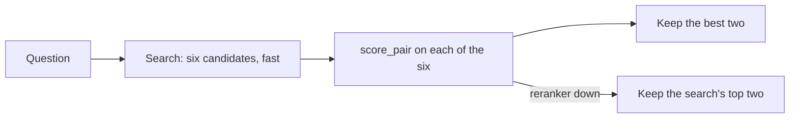

# Rerank the passages

## The problem

Search is fast but rough. It looks at each passage on its own, so the right one often lands third or fourth.
In `first_pass.json` the right passage is in the top two for only one question of six. A reranker is slower and
sharper. It reads the question and a passage together. You run it on the few candidates the search found, not
on the whole library, and the right passage moves up.

## Your challenge

Open `rerank.py`. The function `rerank` returns the first two candidates, as the search ordered them. Make it:

1. Score each candidate with `score_pair(question, candidate["text"])`, once each.
2. Return the ids of the `keep` best scores, best first.
3. If the reranker raises an error, return the first pass's top ids instead. Do not crash.

```bash
cd parts/03-answer-from-the-sources/036-rerank-the-passages/problem
python3 -c "import json; from rerank import rerank; q = json.load(open('first_pass.json'))[0]; print(rerank(q['question'], q['candidates']))"
```

Expect: `['signoff', 'limit']` once you finish. The starter prints `['limit', 'rate']`.



## Do it on your work

Take ten real questions and the passages your own search returns for each. Write down where the right passage
lands before and after reranking. Good looks like this: the right passage is in the top two more often after.

## Done when

- `rerank` returns two ids that came from the candidates.
- The right passage is in the top two for at least five of the six questions.
- `score_pair` is called at most once for each candidate.
- When `score_pair` raises an error, `rerank` still returns two ids.

```bash
bun run verify rerank-the-passages
```

Expect: `Done. All 4 rules pass.`

## If you get stuck

- Sort the positions, not the candidates: `sorted(range(len(candidates)), key=lambda i: -scores[i])`.
- Put the scoring inside `try`, and the fallback in `except`.
- Python's sort keeps the old order for equal scores, so ties go to the first pass.

## Words you will use

- **Reranker:** a second model that reads the question and one passage together and scores how well they match.
- **Candidates:** the short list the first search returns.
- **Recall at two:** the share of questions whose right passage is in the top two.
