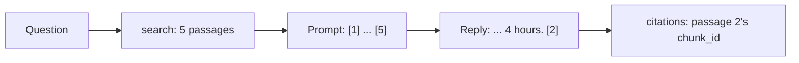

# Cite every answer

## The problem

A grower asks for a rate, and the model answers "1.2 L/ha". Where did that number come from? If nobody can
point to the passage, nobody can check it. An answer that sounds sure and has no source is the most dangerous
kind. The label is the law, so every answer must point to the label text it used.

## Your challenge

`ask.py` searches for 5 passages, sends them to the model with the question, and prints the reply. Its
`citations` list is always empty. Number the passages in the prompt, ask the model to cite the numbers it used,
and turn each number into that passage's chunk id.



Use `ask_model` from `part_kit.py`. On replay, it reads passages that start a line with their number, such as
`[2] Pulsepath product label, page 2: ...`.

Build the index in this folder first, with `uv run python load.py`. Then ask:

```bash
echo '{"question": "How long must Pulsepath stay dry after spraying?"}' | uv run python ask.py
```

Expect: `{"answer": "It must stay dry for 4 hours.", "citations": ["pulsepath-label-p2-1"], "abstained": false}`

For example, the reply on replay is `It must stay dry for 4 hours. [4]`. Passage 4 in your prompt is the chunk
`pulsepath-label-p2-1`, so that id goes in `citations`. The `[4]` comes out of the answer text.

## Done when

- `contract.toml` names an `ask` verb, and it exits 0 on every dev question.
- Every answer cites at least one chunk.
- Every cited chunk id is in the index.
- `ask` makes one model call per question.

```bash
bun run verify cite-every-answer
```

Expect: `Done. All 4 rules pass.`

## If you get stuck

- A citation is a chunk id, such as `pulsepath-label-p2-1`. The number 4 means nothing outside your prompt.
- Ignore a number with no passage behind it, such as `[9]` when you sent 5.
- On replay, put the grower's whole question in the prompt.

## Words you will use

- **Citation:** the id of the passage an answer comes from.
- **Grounded answer:** an answer built only from the passages it cites.
