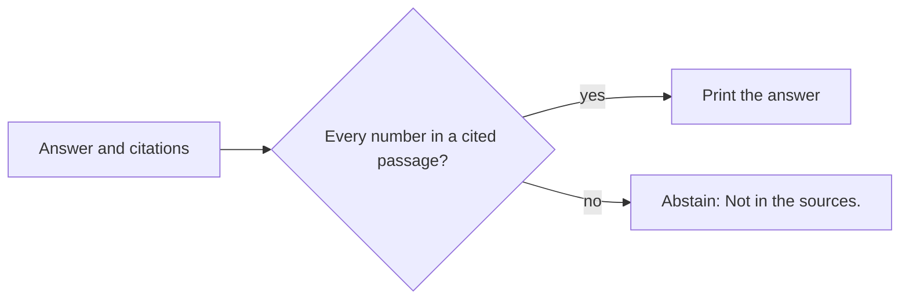

# Check the citations

## The problem

Every answer now has a citation. That does not make it right. Models sometimes cite the passage next to the
right one. And when the search misses, a model often guesses a number and cites passage 1 anyway. A citation
that does not back the answer gives false trust.

## Your challenge

Before `ask.py` prints an answer, check it against its own citations. Every number in the answer must appear in
a passage it cites. If not, do not print the answer. Print an abstention instead:

```json
{ "answer": "Not in the sources.", "citations": [], "abstained": true }
```



For example, question Q-D04 asks when people can walk into a field after Brasslock. On replay the model answers
"People must stay out for 24 hours." But it cites the desk notes, which hold no 24. The right passage,
`brasslock-label-p2-2`, was in the prompt. So your check abstains on this one.

If this folder has no index yet, run `uv run python load.py` first.

```bash
echo '{"question": "How long after spraying Brasslock can people walk into the field?"}' | uv run python ask.py
```

Expect: `{"answer": "Not in the sources.", "citations": [], "abstained": true}`

## Done when

- Every number in every answer appears in a passage it cites.
- 90% or more of the answers cite a page that answers the question.
- 80% or more of the dev questions still get an answer.

```bash
bun run verify check-the-citations
```

Expect: `Done. All 3 rules pass.`

## If you get stuck

- Take the `[2]` markers out before you look for numbers. Otherwise "2" counts as a number in the answer.
- Abstaining on every answer is safe, but useless. The check wants 80% answered.
- The check finds the answer page from the labels in `kit/questions/dev.jsonl`.

## Words you will use

- **Supported answer:** an answer whose cited passages hold what it says.
- **Abstain:** to give no answer on purpose, and say so.
