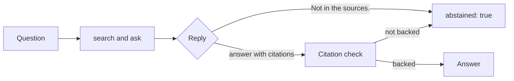

# Say I do not know

## The problem

Growers ask things the documents do not cover. What does Brasslock cost? Will it rain tomorrow? A model with
five passages about spray rates still answers, because it is built to answer. It cites passage 1 and says
something that sounds helpful. On these questions the only right answer is "the sources do not say".

## Your challenge

Tell the model it may reply exactly "Not in the sources." when the passages do not answer the question. When
it does, print an abstention with `"abstained": true`. Keep your citation check from the last step.



For example, Q-O01 asks "What does Brasslock cost per litre?". With the last step's prompt, the replay
model guesses. It says "Brasslock costs about the same as other canola products." It has no number, so your citation check lets
it through. With the new instruction, it says "Not in the sources."

If this folder has no index yet, run `uv run python load.py` first.

```bash
echo '{"question": "What does Brasslock cost per litre?"}' | uv run python ask.py
```

Expect: `{"answer": "Not in the sources.", "citations": [], "abstained": true}`

The 10 out-of-scope dev questions are in `kit/questions/out-of-scope-dev.jsonl`.

## Done when

- 8 or more of the 10 out-of-scope dev questions get `"abstained": true`.
- On the in-scope dev questions, 80% or more still get an answer.
- On the in-scope dev questions, 90% or more of the answers are supported.

```bash
bun run verify say-i-do-not-know
```

Expect: `Done. All 3 rules pass.`

## If you get stuck

- The check reads `abstained`, not the words. "Not in the sources." with `"abstained": false` still fails.
- Ask for the exact sentence, so your code can spot it with `startswith`.

## Words you will use

- **Out of scope:** a question the documents do not answer.
- **Abstention:** an answer that says, on purpose, that the sources do not say.
