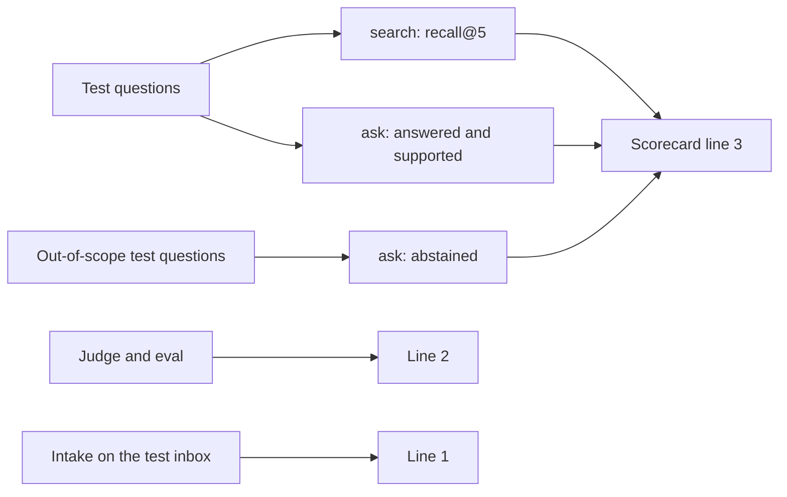
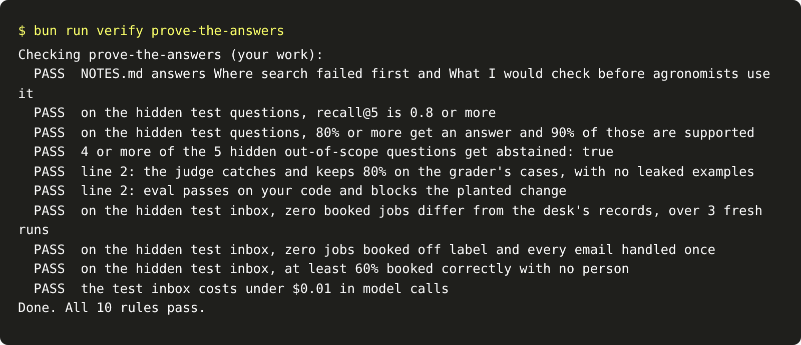

# Prove the answers

## The problem

Your search and your answers work on the 20 dev questions you looked at. Growers will ask others. The grader
holds 10 test questions and 5 more out-of-scope questions. Their answer pages are stored as hashes, so nobody
can read them. Line 3 of the scorecard is yours when the answers hold there, and lines 1 and 2 still hold.

## Your challenge

Write two short answers in `NOTES.md`, from your own runs. Then run the milestone check.



For example, a learner drops the chunk headers to make the index smaller. Dev recall falls, and test recall
falls to 0.7. The check fails it, because a label's second page cannot be found again.

```bash
bun run verify prove-the-answers
```

Expect: `Done. All 10 rules pass.`



## Done when

- `NOTES.md` answers Where search failed first and What I would check before agronomists use it.
- On the hidden test questions, recall@5 is 0.8 or more.
- On the hidden test questions, 80% or more get an answer, and 90% of those are supported.
- 4 or more of the 5 hidden out-of-scope questions get `"abstained": true`.
- Line 2 still holds: the judge agrees with the grader, and the eval blocks the planted change. These are
  two rules.
- Line 1 still holds on the hidden test inbox. These are four rules, the same as in the "Get records you can trust" part's milestone.

## If you get stuck

- Run `bun run verify beat-the-baseline` and `bun run verify say-i-do-not-know` here first.
- If a line 2 rule fails, compare `judge.py` and `eval.py` with your "Measure before you change" files.

## Words you will use

- **Hidden test questions:** questions you never see, used only to score.
- **Supported-answer rate:** the share of answers whose citations back what they say.
