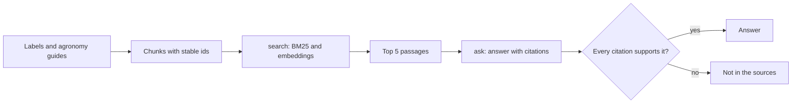

# Answer from the sources

## The problem

Growers ask the desk the same questions every season. Can I mix these two products in one tank? What is the
highest rate on lentils? How long must it stay dry before rain? A wrong answer harms a crop and breaks the
label. The model does not know the co-op's farming guides or the current labels. So it guesses, and it sounds
sure when it does.

For example, a grower asks: "What is the highest rate of Pulsepath on lentils?" The label in
`worlds/tallgrass_bend/seed.json` says 1.2 L/ha. A model with no sources might give any number. In this part,
the system answers from the label and points to the passage it used. If the sources do not say, it answers
that the sources do not say.

## Why it matters

Retrieval means finding the right passages in your documents before the model answers. You can measure and
improve retrieval like any other system. Anthropic tried two methods together, called contextual embeddings
and contextual BM25. They report that this "reduced the top-20-chunk retrieval failure rate by 49% (5.7% →
2.9%)". With reranking, the drop was 67%
([Anthropic, Introducing Contextual Retrieval](https://www.anthropic.com/engineering/contextual-retrieval)).
Those numbers exist for one reason. The team labelled which passage should come back for each question.

## What you build



A chunk is a short piece of a document, such as one paragraph of a label. BM25 is a classic word-matching
search. An embedding turns text into numbers, so that texts with similar meaning sit close together. Recall@5
is the share of questions where the right chunk is in the top 5 results.

## The labs

- Core: [Build a PDF RAG Pipeline with Citations](https://github.com/learnwithparam/live-labs/tree/main/labs/04-rag-pipeline) (live-labs `labs/04-rag-pipeline`, about 20 minutes)
- Core: [Measure RAG Accuracy with Recall@k](https://github.com/learnwithparam/live-labs/tree/main/labs/05-rag-recall) (live-labs `labs/05-rag-recall`, about 20 minutes)
- Optional: [Build Agentic RAG with LangGraph](https://github.com/learnwithparam/live-labs/tree/main/labs/07-agentic-rag), [Enforce Document Permissions in RAG with OpenFGA](https://github.com/learnwithparam/live-labs/tree/main/labs/21-rag-permissions)

## Steps

| Step                  | Minutes | You produce                                   | Done when (what the check reads)                                                                   |
| --------------------- | ------- | --------------------------------------------- | -------------------------------------------------------------------------------------------------- |
| `load-the-documents`  | 30      | An index with stable chunk ids                | Every chunk has `doc_id`, `page`, `text`; a rebuild gives the same ids; every document covered     |
| `search-the-passages` | 20      | A `search` verb                               | Returns chunk ids for every labelled question; recall@5 is printed                                 |
| `beat-the-baseline`   | 20      | A better `search`                             | Recall@5 meets the target and beats the BM25 baseline printed beside it                            |
| `cite-every-answer`   | 20      | An `ask` verb returning `{answer, citations}` | Every answer has at least one citation and every cited id exists                                   |
| `check-the-citations` | 20      | A supported-answer check                      | The part two judge rates 90% or more of cited passages as supporting the answer                    |
| `say-i-do-not-know`   | 20      | Abstention                                    | 8 or more of 10 out-of-scope questions get an explicit not-in-the-sources; in-scope accuracy holds |
| `prove-the-answers`   | 20      | Scorecard line 3                              | Test split recall@5 and supported-answer rate meet targets; lines 1 and 2 pass                     |

The steps take 150 minutes in total. The brief planned `find-the-passage` and `cite-every-answer` as 40
minutes each. Here, each one is split into two steps.

## Walkthrough

TODO(part session): the commands for each step, each with an `Expect:` line. The steps above are planned.
They have no folders yet, so this part has nothing to check:

```bash
bun run verify part answer-from-the-sources
```

Expect: `Part answer-from-the-sources is done: 0/0 steps pass.`
