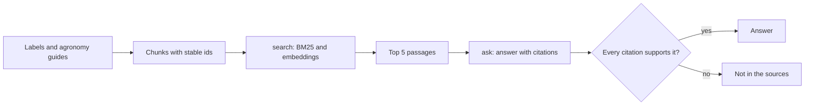

# Answer from the sources

## The problem

Growers ask the desk the same questions every season: can I tank-mix these, what is the highest rate on
lentils, how long before rain. A wrong answer harms a crop and breaks the label. The model does not know the
co-op's agronomy guides or the current labels, and it will guess with confidence.

## Why it matters

Retrieval can be measured and improved like any other system. Anthropic reports that contextual
embeddings plus contextual BM25 "reduced the top-20-chunk retrieval failure rate by 49% (5.7% → 2.9%)", and by
67% with reranking ([Anthropic, Introducing Contextual Retrieval](https://www.anthropic.com/engineering/contextual-retrieval)).
Those numbers exist because the team labelled which passage should come back for each question.

## What you build



## The labs

- Core: [Build a PDF RAG Pipeline with Citations](https://github.com/learnwithparam/live-labs/tree/main/labs/04-rag-pipeline) (live-labs `labs/04-rag-pipeline`, about 20 minutes)
- Core: [Measure RAG Accuracy with Recall@k](https://github.com/learnwithparam/live-labs/tree/main/labs/05-rag-recall) (live-labs `labs/05-rag-recall`, about 20 minutes)
- Optional: [Build Agentic RAG with LangGraph](https://github.com/learnwithparam/live-labs/tree/main/labs/07-agentic-rag), [Enforce Document Permissions in RAG with OpenFGA](https://github.com/learnwithparam/live-labs/tree/main/labs/21-rag-permissions)

## Steps

| Step                  | Minutes | You produce                                   | Done when (what the check reads)                                                                   |
| --------------------- | ------- | --------------------------------------------- | -------------------------------------------------------------------------------------------------- |
| `load-the-documents`  | 30      | An index with stable chunk ids                | Every chunk has `doc_id`, `page`, `text`; a rebuild gives the same ids; every document covered     |
| `search-the-passages` | 20      | A `search` verb                               | Returns chunk ids for every labelled question; recall@5 is printed                                 |
| `beat-the-baseline`   | 20      | A better `search`                             | Recall@5 meets the target and beats the BM25 baseline printed beside it                            |
| `cite-every-answer`   | 20      | An `ask` verb returning `{answer, citations}` | Every answer has at least one citation and every cited id exists                                   |
| `check-the-citations` | 20      | A supported-answer check                      | The part two judge rates 90% or more of cited passages as supporting the answer                    |
| `say-i-do-not-know`   | 20      | Abstention                                    | 8 or more of 10 out-of-scope questions get an explicit not-in-the-sources; in-scope accuracy holds |
| `prove-the-answers`   | 20      | Scorecard line 3                              | Test split recall@5 and supported-answer rate meet targets; lines 1 and 2 pass                     |

150 minutes of steps. `find-the-passage` and `cite-every-answer` (40 minutes each in the brief) are split into two steps each.

## Walkthrough

TODO(part session): the commands for each step, each with an `Expect:` line. The steps above are planned and
have no folders yet, so this part has nothing to check:

```bash
bun run verify part answer-from-the-sources
```

Expect: `Part answer-from-the-sources is done: 0/0 steps pass.`
