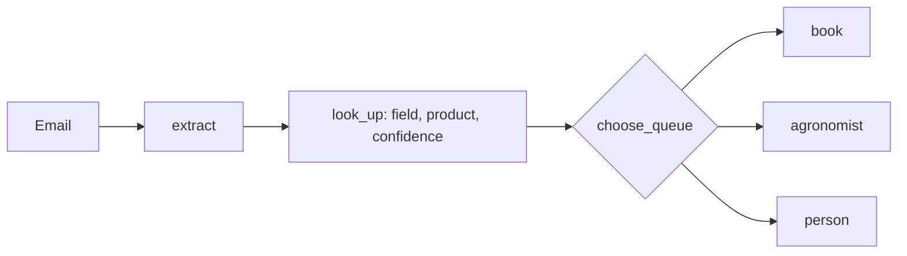

# Route the inbox

## The problem

The "Get records you can trust" part sends every unsure request to one pile for a person. But the desk makes three kinds of decision, not
two. It books a safe job. It asks the agronomist, the co-op's crop expert, to approve a job near the label
limit. Or a person at the desk fixes or refuses the request. One pile hides which is which, so the agronomist
reads requests the desk could fix, and the desk reads ones only the agronomist can approve.

## Your challenge

Write the `route` verb. It reads one email and prints a queue and how sure it is:

- `book`: a safe request below 75% of the label rate.
- `agronomist`: a safe request at 75% of the label rate or more.
- `person`: a rate per acre, a field the email does not name, a product not labelled for the crop, or a rate
  above the label.

`route.py` already reads the record and looks up the grower, field and product, with a match score from 0 to 1.
Its `choose_queue` books everything. Write the rules. The "Get records you can trust" part's `intake.py` holds most of them.



For example, TB-1001 asks for Podshield at 0.38 L/ha. Podshield's label allows 0.5 L/ha, so the rate is 76% of
the label. That goes to the agronomist:

```bash
uv run world email TB-1001 | uv run python route.py
```

Expect: `{"queue": "agronomist", "confidence": 1.0, "reasons": ["0.38 L/ha is 76% of the label rate"]}`

`routes.py` compares your queues and a keyword baseline with the desk's queues in `kit/routes/dev.jsonl`. The
baseline uses no model. It reads only words in the raw email.

```bash
uv run python routes.py
```

Expect: one row per email, then `Wrong queue: yours 0.05, keyword baseline 0.40`.

## Done when

- `contract.toml` names a `route` verb.
- `route` exits 0 on every dev email, with a queue and a confidence from 0 to 1.
- The queue differs from the desk's on 10% of dev emails or fewer.
- `route` picks the wrong queue less often than the keyword baseline.

```bash
bun run verify route-the-inbox
```

Expect: `Done. All 4 rules pass.`

## If you get stuck

- Check the rate per acre first. A rate per acre looks safe, because its number is small.
- Compare the rate with the label of the product you found, not with the number the grower wrote.

## Words you will use

- **Routing:** choosing the queue a request goes to.
- **Confidence:** how sure the router is, from 0 to 1. Here it is how closely the names matched.
- **Baseline:** a plain method with no model, to compare with.
