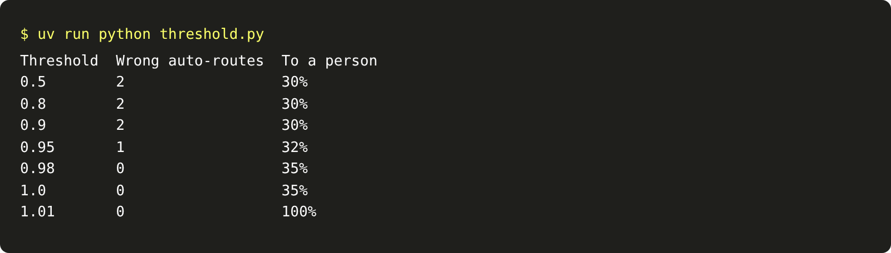
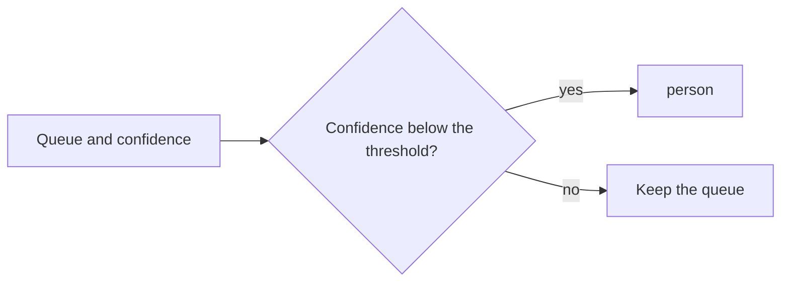

# Send unsure to a person

## The problem

Your router picks the right queue for 38 of 40 dev emails. The two it gets wrong are the worst kind. "Stemshure"
and "Pulse Path" are misspelled, so the names only nearly match. The router books them anyway, with no person.
A wrong queue that a person sees costs a minute. A wrong booking that nobody sees can cost a crop.

## Your challenge

Add a confidence threshold to `route.py`. Say the router would book a request or send it to the agronomist.
If its confidence is below the threshold, send it to a person instead. Pick the threshold from the numbers,
not by feel.

```bash
uv run python threshold.py
```

Expect: one row per threshold, with the wrong auto-routes and the share sent to a person.



For example, at 0.9 the two misspelled emails still go through. Their matches are 0.94 and 0.95. At 0.95 one
still goes through, because 0.95 is not below 0.95. At 0.98 there are 0 wrong auto-routes, and 35% of emails go to a person. At 1.01 every email goes to a person. That is safe, but
nobody is helped.



## Done when

- Zero dev emails are booked or sent to the agronomist when the desk chose another queue.
- 40% of dev emails or fewer go to a person.
- The queue still differs from the desk's on 10% of dev emails or fewer.

```bash
bun run verify send-unsure-to-a-person
```

Expect: `Done. All 3 rules pass.`

## If you get stuck

- Apply the threshold only to `book` and `agronomist`. A request already for a person stays there.
- Choose the lowest threshold with 0 wrong auto-routes. A higher one sends safe requests to a person.

## Words you will use

- **Threshold:** the confidence below which a request goes to a person.
- **Auto-route:** a queue chosen with no person, such as booking a job.
- **Wrong auto-route:** an auto-route the desk would not have chosen. It is the costly mistake.
