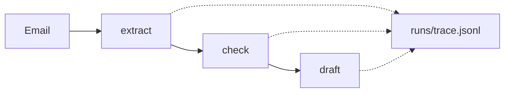

# Chain the steps

## The problem

A request now passes through several steps: read the email, decide the queue, write to the grower. When an
answer is wrong, you need to know which step went wrong. If you only see the end, you must guess. A grower who
says "you booked the wrong field" deserves an answer from the record, not a guess.

## Your challenge

`chain.py` takes every email on the desk through three steps: `extract`, `check` and `draft`. Each step takes
the output of the step before it. Make each step write one line to `runs/trace.jsonl` with the email id, the
step's name, its input and its output.



For example, the `check` line for TB-1001 looks like this, shortened:

```json
{
  "run_id": "TB-1001",
  "step": "check",
  "input": { "email_id": "TB-1001", "record": { "...": "..." } },
  "output": { "queue": "agronomist", "...": "..." }
}
```

Keep `uv run world serve` running in a second terminal. Then:

```bash
uv run python chain.py
```

Expect: `{"emails": 40}`, and `runs/trace.jsonl` with three lines per email.

Each run adds its lines to the end of the trace. Delete `runs/trace.jsonl` before you run again, or you see six
lines per email.

## Done when

- `contract.toml` names a `chain` verb, and it exits 0 on the dev inbox.
- The trace holds `extract`, `check` and `draft` for every inbox email, in that order.
- Every trace line holds the step's input and its output.
- Each step's input is the output of the step before it.

```bash
bun run verify chain-the-steps
```

Expect: `Done. All 4 rules pass.`

## If you get stuck

- Write one small function that runs a step and writes its line. Use it for all three steps.
- Write the input too, not only the output. The input shows where a value first went wrong.

## Words you will use

- **Chain:** steps run one after another, each using the last one's output.
- **Trace:** the saved record of each step's input and output.
- **Run id:** the id that ties a trace's lines together. Here it is the email id.
