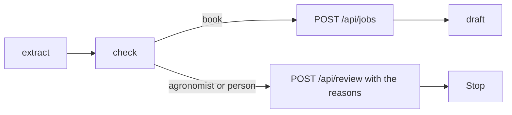

# Stop the chain

## The problem

Your chain drafts a message for every email, even when the check says a person must look. A message that says
"booked" for a request the desk refused is worse than no message. And so far nothing reaches the application
system: no job is booked, and no request reaches the review queue.

## Your challenge

Make the chain act on the check. When the queue is `book`, book the job and draft the message. For any other
queue, send the email to the review queue with the check's reasons, and stop. Nothing is drafted for it. For
now the agronomist's requests go to review too. The next step makes them wait.



For example, TB-1006 asks for Glyfallow 540 at 0.97 L per acre. The check says `person`, with the reason "the
rate is given per acre; the desk books L/ha". The chain sends that to `/api/review` and stops. Its trace has
`extract` and `check`, and no `draft`.

Keep `uv run world serve` running, reset the system, then run the chain and open http://127.0.0.1:8100:

```bash
uv run world reset && uv run python chain.py
```

Expect: `{"emails": 40}`, then 15 booked jobs and 25 emails waiting for a person on the jobs board.

## Done when

- `chain` exits 0, and every email is booked or with a person, once each.
- Zero booked jobs differ from the desk's records, and zero are off label.
- Every email in the review queue has a reason.
- A failed check stops the chain: no email in the review queue has a draft.

```bash
bun run verify stop-the-chain
```

Expect: `Done. All 4 rules pass.`

## If you get stuck

- Return right after you send an email to review. A draft comes only after a booking.
- Send the check's reasons as the review reason. The person at the desk reads them first.

## Words you will use

- **Review queue:** the list of requests waiting for a person, with the reason for each.
- **Stop condition:** the result that ends the chain early, here a failed check.
