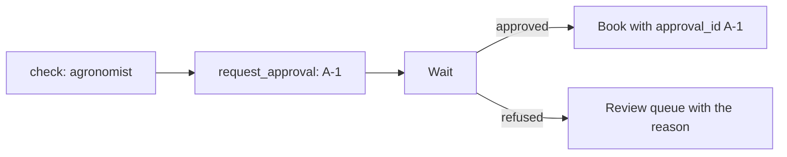

# Wait for approval

## The problem

A job near the label limit needs the agronomist's yes. The agronomist answers from the field, maybe an hour
later. Sending these requests to the review queue loses the reason they are there. Booking them without the yes
breaks the desk's own rule. The chain must ask, wait, and book only after the answer, with a record of who
said yes.

## Your challenge

For each request in the `agronomist` queue, ask for approval with `approvals.request_approval` from
`part_kit.py`. Handle the other emails as before. Then wait: ask `approvals.decision` for each answer until none
is left. After a yes, book the job with `"approval_id"` in it. After a no, send the email to the review queue
with the agronomist's reason.



Keep `uv run world serve` running in its own terminal. Run the chain in this terminal. It waits:

```bash
uv run world reset && uv run python chain.py
```

Expect: `Waiting for 11 approvals. See them with: uv run python ../../kit/approvals.py list`. That is the
line the sample answer prints. Print a line like it, so you know the chain is waiting.

Then answer as the agronomist, from one more terminal in the same folder:

```bash
uv run python ../../kit/approvals.py approve A-1
```

Expect: `A-1 is approved.`

For example, after you approve A-1, the chain books TB-1001 with `"approval_id": "A-1"`. The world keeps the
whole job in its audit log, so anyone can see who approved it. Approve or refuse the rest, and the chain exits.

## Done when

- The chain asks for one approval per agronomist email, keeps waiting, and books none of them yet.
- After a yes, each approved email is booked once, with its approval id.
- After a no, the email is not booked, and waits for a person with the reason.
- The chain exits 0, every email is handled once, and zero jobs are booked wrong.

```bash
bun run verify wait-for-approval
```

Expect: `Done. All 4 rules pass.`

## If you get stuck

- Ask for every approval first, then wait for them all. Waiting inside the loop holds up the whole inbox.
- `POLL_SECONDS` sets how often the chain asks. The check sets it to 0.1.
- `uv run world reset` does not clear the approvals. A second run asks again, as A-12 to A-22. To start again
  at A-1, delete `runs/approvals.db` before you run.

## Words you will use

- **Approval:** a person's recorded yes or no, with an id.
- **Polling:** asking again and again, with a pause, until there is an answer.
