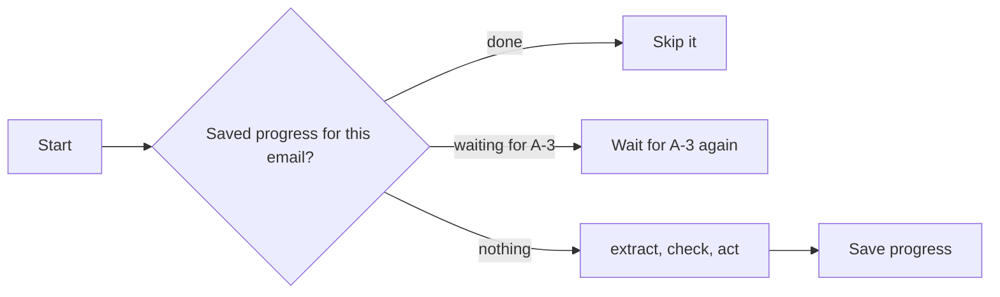

# Survive the crash

## The problem

The chain waits for the agronomist, maybe for an hour. In that hour the laptop sleeps, or the server restarts.
Your chain keeps what it knows in memory, so a crash forgets it. When you start it again, it books the safe jobs
a second time. It asks the agronomist again, with new ids, and ignores the yes the agronomist already gave.

## Your challenge

Make the wait durable. Save the chain's progress to a file as it goes: which emails are done, and which approval
each waiting email has. When the chain starts, read that file. Skip the emails that are done. For a waiting
email, wait again for the same approval id. Never ask twice.



For example, the check kills your chain with SIGKILL while it waits for 11 approvals. Then it approves 10 and
refuses 1, and starts your chain again. A durable chain finds its 11 saved approval ids and their answers. It
books 10 jobs, each once. A chain that kept its state in memory books the first 15 jobs again. It also asks 11
new questions that nobody answers.

Try it yourself. Start the chain, then stop it with `kill -9` from another terminal:

```bash
uv run world reset && uv run python chain.py & sleep 3 && kill -9 $!
```

Expect: `Waiting for 11 approvals...`, then the shell reports that the process was killed.

## Done when

- After a SIGKILL during the wait and a restart, each approved email is booked once, with its approval id.
- There is one approval request per agronomist email, never two.
- The restarted chain exits 0, every email is handled once, and zero jobs are booked wrong.

```bash
bun run verify survive-the-crash
```

Expect: `Done. All 3 rules pass.`

## If you get stuck

- Save the approval id before you start to wait. A crash can come at any moment after the request.
- SQLite is in Python's standard library. One small table, keyed by email id, is enough.
- Before you book, check the system for a job with the same email id. A crash can come just after a booking.

## Words you will use

- **Durable:** saved outside the process, so it lives through a crash.
- **SIGKILL:** a signal that stops a process at once, with no chance to clean up.
- **Idempotent:** safe to do twice. Booking an email that is already booked changes nothing.
