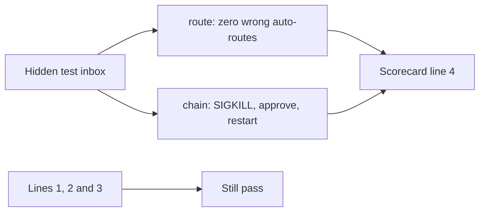
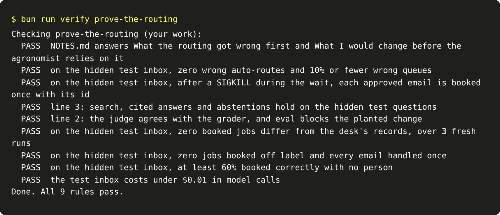

# Prove the routing

## The problem

Your router and your durable wait work on the 40 dev emails. The grader runs them on the 20 hidden test emails,
with the test inbox's own approvals and a crash in the middle. Line 4 of the scorecard is yours when they hold
there, and lines 1 to 3 still hold.

## Your challenge

Write two short answers in `NOTES.md`, from your own runs. Then run the milestone check.



For example, a learner drops the confidence threshold to send fewer emails to a person. The dev inbox still
looks fine at 5% wrong. The test inbox has one misspelled product, and it is routed with no person. The check
fails it.

```bash
bun run verify prove-the-routing
```

Expect: `Done. All 9 rules pass.`



## Done when

- `NOTES.md` answers What the routing got wrong first and What I would change before the agronomist relies
  on it.
- On the hidden test inbox, zero wrong auto-routes, and 10% or fewer wrong queues.
- On the hidden test inbox, after a SIGKILL during the wait, each approved email is booked once with its id.
- Line 3 still holds: search, cited answers and abstentions on the hidden test questions.
- Line 2 still holds: the judge agrees with the grader, and the eval blocks the planted change.
- Line 1 still holds on the hidden test inbox. These are four rules, the same as in part one's milestone.

## If you get stuck

- Run `bun run verify send-unsure-to-a-person` and `bun run verify survive-the-crash` here first.
- If an earlier line fails, compare the file it names with your own from that part.

## Words you will use

- **Milestone:** a step that proves a part on data you have not seen.
- **Wrong auto-route:** a request booked or sent to the agronomist when the desk would not have.
