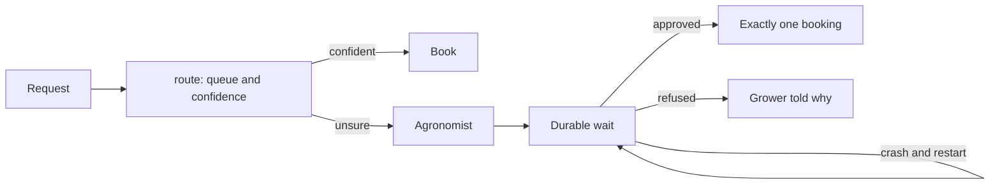

# Decide and wait for a person

## The problem

Part one sends unsure requests to a review queue and forgets them. Real requests need a decision. The desk can
book the job, send it to the agronomist, or refuse it. An agronomist is the co-op's crop expert. A job near
the label limit needs the agronomist's approval, and the agronomist answers from the field, not at a computer.
The process might crash while it waits. Then the job must not be booked twice, and it must not be lost.

For example, `worlds/tallgrass_bend/inbox/dev/TB-1001.txt` asks for Podshield at 0.38 L/ha. The label limit
is 0.5 L/ha, so the rate is safe but not far from the limit. In this part, a request like that can wait for
the agronomist to say yes. If the process crashes during the wait, the job is still booked exactly once.

## Why it matters

Sorting documents fast is now normal. DXC is a company that runs core insurance systems. Anthropic's case
study on DXC says its claims documents are now "classified in under a second". This is a vendor's claim about
its own customer ([Anthropic, DXC case study](https://claude.com/customers/dxc)).
When sorting is that fast, the hard part is the wait for a person. Fast sorting that is wrong costs more than
the old pile of work. So does an approval that is lost in a crash.

## What you build



Routing means choosing which queue a request goes to. Confidence is how sure the system is about that choice.
A durable wait is a wait that is saved to disk, so it lives through a crash and a restart.

## The labs

- Core: [Build Durable AI Workflows with Temporal](https://github.com/learnwithparam/live-labs/tree/main/labs/10-durable-workflow) (live-labs `labs/10-durable-workflow`, about 20 minutes)
- Core: [Build an AI Workflow with Mastra](https://github.com/learnwithparam/live-labs/tree/main/labs/08-ai-workflow) (live-labs `labs/08-ai-workflow`, about 20 minutes)
- Optional: [Score Risk with a Decision Model](https://github.com/learnwithparam/live-labs/tree/main/labs/19-decision-ai)

## Steps

| Step                      | Minutes | You produce                                    | Done when (what the check reads)                                                                   |
| ------------------------- | ------- | ---------------------------------------------- | -------------------------------------------------------------------------------------------------- |
| `route-the-inbox`         | 30      | A `route` verb returning `{queue, confidence}` | Wrong queues at or below target on dev; a non-model baseline printed beside it                     |
| `send-unsure-to-a-person` | 20      | A confidence threshold                         | At the threshold, wrong auto-routes within the limit; the share sent to a person printed           |
| `chain-the-steps`         | 20      | A workflow: extract, check, draft              | Each step writes its input and output to the trace                                                 |
| `stop-the-chain`          | 20      | A chain that stops on a failed check           | A failed check stops the chain and the item lands in review with the reason                        |
| `wait-for-approval`       | 20      | A durable approval wait                        | The run waits; approving through the world books exactly one job with the approval id              |
| `survive-the-crash`       | 20      | The same wait, crash-safe                      | The check kills the process during the wait, restarts, approves; one write in the system of record |
| `prove-the-routing`       | 20      | Scorecard line 4                               | Routing and the crash test pass on the test split; lines 1 to 3 pass                               |

The steps take 150 minutes in total. The brief planned `chain-the-steps` and `wait-for-approval` as 40
minutes each. Here, each one is split into two steps. Hollin Bank Home Care (`worlds/README.md`) is the
project brief that matches this part.

## The kit

This part adds the desk's queues and the agronomist's approvals to the world. They live in
[`kit/`](kit/README.md). Your code finds them through `part_kit.py`. Messages this part can print are in
[troubleshooting.md](troubleshooting.md).

## Walkthrough

You work in each step's `problem/` folder. Run every command from there. The commands need no model key. Start
the application system in a second terminal, and leave it running:

```bash
uv run world serve
```

Expect: `The spray desk is open at http://127.0.0.1:8100 (dev inbox). Stop it with Ctrl+C.`

Route one email:

```bash
cd parts/04-decide-and-wait/01-route-the-inbox/problem && uv run world email TB-1001 | uv run python route.py
```

Expect: one line of JSON with `queue` and `confidence`. The starter says `"queue": "book"` for every email.

Compare your router with the desk and the keyword baseline:

```bash
uv run python routes.py
```

Expect: one row per dev email, then a line that starts `Wrong queue: yours`.

Run the chain on a fresh system. From `wait-for-approval` on, it waits for the agronomist:

```bash
uv run world reset && uv run python chain.py
```

Expect: `{"emails": 40}` at first. Once you add approvals it prints `Waiting for 11 approvals...` and waits.

Answer as the agronomist from a third terminal, in the same folder:

```bash
uv run python ../../kit/approvals.py list
```

Expect: one line per request, such as `A-1  TB-1001  0.38 L/ha  waiting`, or `No approval requests yet.`

Check one step, or the whole part, from the repo root:

```bash
bun run verify route-the-inbox
```

Expect: `FAIL` lines with `Try next:` on the starter, then `Done. All 4 rules pass.`

```bash
bun run verify part decide-and-wait
```

Expect: one line per step, then `Part decide-and-wait is done: 7/7 steps pass.` once every step passes.

## Finished

You now have a desk that decides. Each request goes to the right queue, and an unsure one goes to a person. A
chain traces every step and stops when a check fails. A job near the label limit waits for the agronomist's
yes, and the wait lives through a crash without booking twice. Line 4 of the scorecard is yours.

The next part, [Let it act](../05-let-it-act/README.md), gives the model tools to change the world itself. You
grade it by the world's state after each task, not by what it says.
