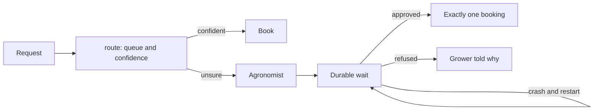

# Decide and wait for a person

## The problem

Part one sends unsure requests to a review queue and forgets them. Real requests need a decision: book
it, send it to the agronomist, or refuse it. A job near the label limit needs the agronomist's sign-off, and the
agronomist answers from the field, not at a terminal. If the process crashes while it waits, the job must not
be booked twice or lost.

## Why it matters

Routing documents fast is now routine. Anthropic's case study on DXC, which runs core insurance systems,
says its claims documents are now "classified in under a second" ([Anthropic, DXC case study](https://www.anthropic.com/customers/dxc), a vendor's claim about its
customer). Speed makes the hard part the wait for a person: routing that is fast and wrong, or an approval
that is lost in a crash, costs more than the backlog did.

## What you build



## The labs

- Core: [Build Durable AI Workflows with Temporal](https://github.com/learnwithparam/live-labs/tree/main/labs/10-durable-workflow) (live-labs `labs/10-durable-workflow`, about 20 minutes)
- Core: [Build an AI Workflow with Mastra](https://github.com/learnwithparam/live-labs/tree/main/labs/08-ai-workflow) (live-labs `labs/08-ai-workflow`, about 20 minutes)
- Optional: [Score Risk with a Decision Model](https://github.com/learnwithparam/live-labs/tree/main/labs/19-decision-ai)

## Steps

| Step | Minutes | You produce | Done when (what the check reads) |
|---|---|---|---|
| `route-the-inbox` | 30 | A `route` verb returning `{queue, confidence}` | Wrong queues at or below target on dev; a non-model baseline printed beside it |
| `send-unsure-to-a-person` | 20 | A confidence threshold | At the threshold, wrong auto-routes within the limit; the share sent to a person printed |
| `chain-the-steps` | 20 | A workflow: extract, check, draft | Each step writes its input and output to the trace |
| `stop-the-chain` | 20 | A chain that stops on a failed check | A failed check stops the chain and the item lands in review with the reason |
| `wait-for-approval` | 20 | A durable approval wait | The run waits; approving through the world books exactly one job with the approval id |
| `survive-the-crash` | 20 | The same wait, crash-safe | The check kills the process during the wait, restarts, approves; one write in the system of record |
| `prove-the-routing` | 20 | Scorecard line 4 | Routing and the crash test pass on the test split; lines 1 to 3 pass |

150 minutes of steps. `chain-the-steps` and `wait-for-approval` (40 minutes each in the brief) are split into two steps each. Hollin Bank Home Care (`worlds/README.md`) is the matching project brief.

## Walkthrough

TODO(part session): the commands for each step, each with an `Expect:` line. The steps above are planned and
have no folders yet, so this part has nothing to check:

```bash
bun run verify part decide-and-wait
```

Expect: `Part decide-and-wait is done: 0/0 steps pass.`
