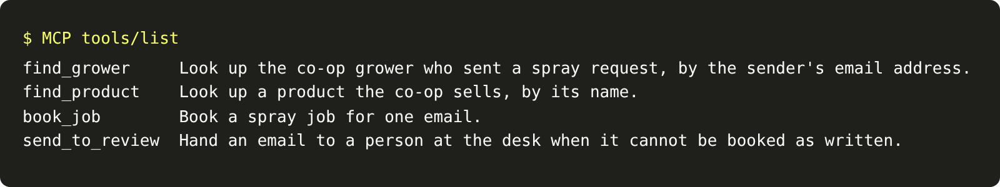

# Write the tools

## The problem

The desk wants an agent to book spray jobs. An agent is a model that calls tools in a loop until a task is
done. A tool is a function the agent may call, such as one that books a job.

The model cannot read your code. It only reads the name, the description and the input schema of each tool.
The input schema lists each argument and its type. If a description is empty, the model guesses what the tool
does. If the input has no types, the model guesses the arguments too.

## Your challenge

`tools.py` has four working functions: `find_grower`, `find_product`, `book_job` and `send_to_review`. Its
`TOOLS` list names them, but every description is empty and no input is typed. Describe each tool for the
model.

`server.py` is an MCP server, and you do not need to change it. MCP is the Model Context Protocol: a standard
way for a client, such as Claude Desktop or MCP Inspector, to list and call your tools.

For example, ask the server for its tools:

```bash
echo '{"jsonrpc":"2.0","id":1,"method":"tools/list"}' | uv run python server.py
```

Expect: one line of JSON with `"tools"`. In the starter, each tool has `"description": ""`.

A good description says what the tool does and what it returns. Here is the one for `find_grower` in the sample
solution: "Look up the co-op grower who sent a spray request, by the sender's email address. Returns the grower
and every field they farm." The real one also names the field values it returns. Its input has one
typed argument, `"email": {"type": "string", ...}`, and `"required": ["email"]`.



## Done when

- `contract.toml` names a `tools` verb that starts your MCP server.
- The server answers `tools/list` with 3 to 6 tools.
- Every tool has a description of at least 12 words.
- Every argument has a type, and each tool lists its required arguments.
- The tools can book a job and send an email to a person.

```bash
bun run verify write-the-tools
```

Expect: `Done. All 5 rules pass.`

## If you get stuck

- Write each description for a new colleague on their first morning at the desk. What would they need to
  know?
- Copy the shape of one tool from the JSON Schema of `worlds/tallgrass_bend/schema.json`: `"type": "object"`,
  then `"properties"`, then `"required"`.
- Mention the ids a tool returns, such as `field_id` and `product_code`. The agent needs them for `book_job`.

## Words you will use

- **Agent:** a model that calls tools in a loop until a task is done.
- **Tool:** a function the agent may call, described by a name, a description and an input schema.
- **MCP:** the Model Context Protocol, a standard way for any client to list and call your tools.
