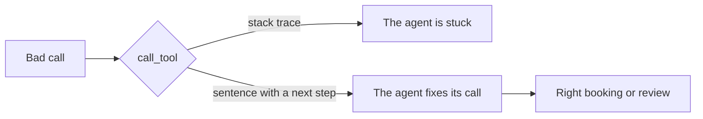

# Explain the errors

## The problem

Agents make mistakes when they call tools. They misspell a product. They forget an argument. They try to book
a rate the label does not allow. What happens next depends on the answer the tool gives.

If the tool answers with a Python stack trace, the model cannot act on it. It gives up or tries the same call
again. If the tool answers with one clear sentence that says what to do next, the model can fix its own
mistake.

## Your challenge

Make every tool error a sentence the agent can act on. Make `book_job` refuse any job the desk would not book.

For example, the grower in `worlds/tallgrass_bend/inbox/dev/TB-1008.txt` writes "Stemshure", not "Stemsure".
With the starter, `find_product("Stemshure")` answers with a stack trace that ends in `StopIteration`. With the
sample solution, it answers:

> The co-op sells no product called "Stemshure". It sells: Glyfallow 540, Brasslock, Tillerguard, Pulsepath,
> Stemsure, Podshield. Call find_product again with one of these names.

You can ask the server yourself. First start `uv run world serve` in a second terminal. Then run this in the
`problem/` folder:

```bash
echo '{"jsonrpc":"2.0","id":1,"method":"tools/call","params":{"name":"find_product","arguments":{"name":"Stemshure"}}}' | uv run python server.py
```

Expect: one line of JSON with `"isError": true`. In the starter, its `"text"` starts with `Traceback`.

The model reads the good error, calls `find_product("Stemsure")`, and books the job. The desk's own record for TB-1008
has the same job, so a good error turns a lost request into a right booking.

`book_job` must refuse three kinds of job, as your rules in part one did:

- a rate above the label, or a crop the label does not cover;
- an email that gives the rate per acre;
- a field the email does not name.

`book_job` gets the `email_id`, so it can read the email from the application system and check it.



## Done when

- Every bad call returns a result marked `isError`, and the server keeps answering.
- No error shows a stack trace or a bare exception name.
- An unknown product's error lists the products. An unknown field's error names `find_grower`.
- An unknown sender's error says to send the email to review. A missing argument's error names it.
- `book_job` refuses an above-label rate, an acre rate and an unnamed field, and says why.
- No refused call books a job, and a good call still works.

```bash
bun run verify explain-the-errors
```

Expect: `Done. All 8 rules pass.`

## If you get stuck

- Raise `ToolError("...")` in each function, and catch it in `call_tool`. Return `(message, True)`.
- Copy the label rule from `intake.py` in part one. For example, see
  `parts/01-get-records-you-can-trust/04-check-against-truth/solution/intake.py`. Then add the acre and field
  name rules.
- End every message with the next step, such as "Send this email to review."

## Words you will use

- **Tool error:** the answer a tool gives when it cannot do the job. The agent reads it like any other answer.
- **Stack trace:** the list of Python calls that led to a crash. It helps a programmer, not a model.
- **isError:** the MCP flag that marks a tool answer as an error.
