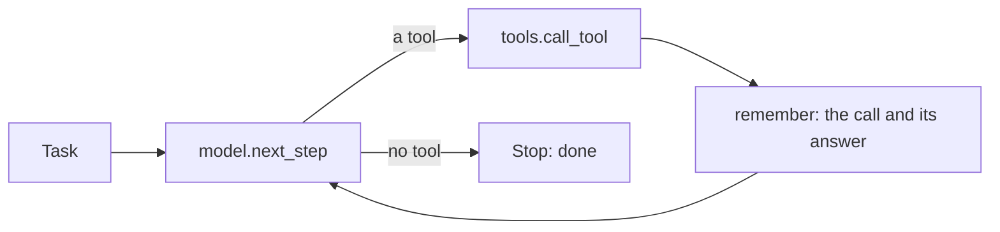

# Run the loop

## The problem

The tools work, but nothing calls them yet. An agent needs a loop. It asks the model what to do next, runs
the tool the model picks, and gives the model the tool's answer. It does this again and again until the model
answers with no tool.

## Your challenge

`agent.py` is the `act` verb. It reads one task on stdin, as `{"email_id", "text"}`. It prints one line of
JSON with a `run_id` and a `stop_reason`. Right now it asks the model once, runs one tool and stops. Turn it
into a loop.

`model.py` plays the model, and you do not need to change it. With replay, it acts like a real model reading
the request. It makes the same mistakes as the replay in part one. `prompt.md` holds the instructions the
model reads first.

For example, run the starter on one email while `uv run world serve` runs in another terminal:

```bash
uv run world email TB-1001 | uv run python agent.py
```

Expect: `{"run_id": "...", "stop_reason": "one turn only", "tool_calls": 1, ...}`. The agent called
`find_grower` and stopped, so TB-1001 is not booked.

With the sample solution, the same command prints `"stop_reason": "done"` and `"tool_calls": 3`. The agent
called `find_grower`, `find_product` and `book_job`. Each call is a line in `runs/trace.jsonl`.



## Done when

- `contract.toml` names an `act` verb.
- `act` exits 0 on every dev email, 3 fresh runs out of 3.
- `act` prints one line of JSON with a `run_id` and a `stop_reason`.
- Every dev email ends booked or with a person, once each.
- At least half the dev emails end with a booked job.

```bash
bun run verify run-the-loop
```

Expect: `Done. All 5 rules pass.`

## If you get stuck

- After each tool call, use `remember()` to add both the call and the answer to `messages`. If the model never
  sees the answer, it cannot take the next step.
- Keep a hard stop such as `MAX_TURNS = 30`, so a loop that goes wrong cannot run forever.
- A tool error is still an answer. Give it to the model like any other.

## Words you will use

- **Agent loop:** ask the model, run its tool, give back the answer, repeat until it stops.
- **Stop reason:** why the loop ended, such as `done`, when the model answered with no tool.
- **Trace:** a record of every tool call in a run, here one line per call in `runs/trace.jsonl`.
